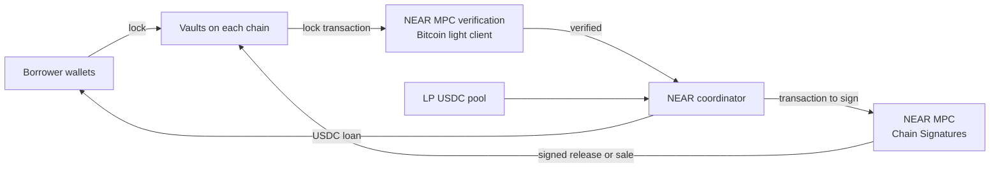

# Kanso

**One USDC loan against crypto you hold on many chains.**

Kanso lets a borrower combine BTC, NEAR, SOL, ETH and other native assets, held in different wallets on different chains, into one collateral basket and borrow USDC against it. Collateral stays locked on its own chain. A coordinator contract on NEAR keeps the single debt balance, the combined health factor and every permission to move collateral.

Kanso uses no bridge and no third-party messaging protocol. [NEAR MPC](https://github.com/near/mpc) carries every cross-chain step:

- **Reading other chains:** NEAR MPC foreign-transaction verification confirms deposits and releases on the source chain before the coordinator acts on them. Bitcoin uses a Bitcoin light client on NEAR instead.
- **Acting on other chains:** [Chain Signatures](https://docs.near.org/chain-abstraction/chain-signatures), also run by NEAR MPC, signs the release and sale transactions that the coordinator builds.

Built on NEAR for the NEAR hackathon. Live on testnet across 11 chains.

[Coordinator on NearBlocks](https://testnet.nearblocks.io/address/kanso-coordinator-9774b8b352.testnet) · [Deployment manifest](deployments/testnet.json) · [Agent guide](AGENTS.md)

## Contents

- [Why Kanso](#why-kanso)
- [How it works](#how-it-works)
- [Built on NEAR](#built-on-near)
- [Supported chains](#supported-chains)
- [Testnet deployment](#testnet-deployment)
- [Repository layout](#repository-layout)
- [Getting started](#getting-started)
- [Testing](#testing)
- [Testnet operations](#testnet-operations)
- [Security model and limitations](#security-model-and-limitations)
- [License](#license)

## Why Kanso

A holder with $600 of ETH on Arbitrum, $400 of SOL and $500 of NEAR usually has to open three loans on three protocols, bridge everything to one chain, or sell. Kanso treats those holdings as one $1,500 basket with one debt and one health factor. At an illustrative 50% loan-to-value, that basket supports a $750 USDC loan.

Nothing is bridged or wrapped, and Kanso issues no basket token. The basket is a record on the NEAR coordinator.

## How it works

1. **Choose a basket.** Pick assets and amounts across supported chains.
2. **Connect only the wallets you need.** Kanso asks for the wallets that hold the selected assets, plus a NEAR account for the loan.
3. **Pick an offer.** LP-funded pools quote fixed-APR offers. Accepting one reserves the principal on NEAR.
4. **Lock collateral.** Each asset is locked in a vault on its own chain. Legs run in parallel with separate progress.
5. **Verify every leg on NEAR.** The coordinator asks NEAR MPC to verify each lock transaction (`verify_foreign_transaction`). Bitcoin locks are proven against the Bitcoin light client. Funding waits until every leg is verified.
6. **Receive USDC.** One payout goes to the borrower's NEAR account.
7. **Manage one loan.** Repay with USDC, other wallet tokens or pledged collateral. Top up, withdraw excess or swap collateral without closing the loan. Unhealthy or overdue loans are partially liquidated, and any surplus returns to the borrower.
8. **Release or sell collateral.** The coordinator builds the exact transaction for the source chain and has NEAR MPC sign it through Chain Signatures. A relayer broadcasts it, and the coordinator verifies that it landed, the same way it verifies deposits, before the loan record changes.



Interest is simple, fixed-rate and accrues per second (Actual/365). Repayments pay fees first, then interest, then principal. Health is one number for the whole basket: the sum of each asset's value times its liquidation threshold, divided by debt.

## Built on NEAR

| Component                                                                                        | How Kanso uses it                                                                                                                                                     |
| ------------------------------------------------------------------------------------------------ | --------------------------------------------------------------------------------------------------------------------------------------------------------------------- |
| NEAR coordinator contract                                                                        | Holds pools, offers, loans, risk checks, repayment, liquidation and settlement. It is the source of truth for debt and custody permissions.                           |
| [Chain Signatures](https://docs.near.org/chain-abstraction/chain-signatures)                     | Controls each remote vault through MPC-derived keys. The coordinator builds the complete transaction before requesting a signature and never signs an arbitrary hash. |
| [NEAR MPC](https://github.com/near/mpc) foreign-transaction verification                         | Verifies deposits and releases on EVM chains, Solana, Sui and Starknet before the coordinator credits or releases anything.                                           |
| [Bitcoin light client](https://github.com/Near-One/btc-light-client-contract)                    | Verifies Bitcoin deposit and spend inclusion proofs (`btc-client-v4.testnet`).                                                                                        |
| [Circle USDC on NEAR](https://developers.circle.com/stablecoins/usdc-contract-addresses#testnet) | Loan and pool asset. Pool deposits and repayments arrive through NEP-141 `ft_transfer_call`.                                                                          |
| NEP-413 and NEAR Connect                                                                         | Signed-message login to the API and NEAR wallet connection in the web app.                                                                                            |

## Supported chains

All 11 chains have passed a live deposit-and-release test on testnet. Each record links to the NEAR transaction that registered the chain's manifest after that test.

| Chain             | Collateral | Network          | Custody                                  | Record                                                                                    |
| ----------------- | ---------- | ---------------- | ---------------------------------------- | ----------------------------------------------------------------------------------------- |
| NEAR              | NEAR       | Testnet          | Coordinator native-collateral module     | [coordinator](https://testnet.nearblocks.io/address/kanso-coordinator-9774b8b352.testnet) |
| Bitcoin           | BTC        | Testnet3         | Per-leg MPC-derived P2WPKH address       | [record](https://testnet.nearblocks.io/txns/8GUbt3w5sotTJSks8nPy9pp7dqYMWJJ21xWkSaQB38Tx) |
| Solana            | SOL        | Devnet           | Vault program with per-lock PDAs         | [record](https://testnet.nearblocks.io/txns/5XiobA1NcAGeLiADSP7a6WyXacjapJ5vKWctxZt9nEpt) |
| Base              | ETH        | Sepolia (84532)  | `CollateralVault.sol`                    | [record](https://testnet.nearblocks.io/txns/BUfu8LfpA5mFBHetKogJMhBBf82qHc78Q6yvbFRQYzoW) |
| Arbitrum          | ETH        | Sepolia (421614) | `CollateralVault.sol`                    | [record](https://testnet.nearblocks.io/txns/DcYrFApSzRe6Vv9yMpSJWzqjQPU9fR7PgaMei1dEGCmL) |
| BNB Chain         | BNB        | Testnet (97)     | `CollateralVault.sol`                    | [record](https://testnet.nearblocks.io/txns/F5QAzXbgCQVjhdN2aFyttmWppz6JHoj2ccvA9T1JjUiF) |
| Polygon           | POL        | Amoy (80002)     | `CollateralVault.sol`                    | [record](https://testnet.nearblocks.io/txns/F2xhMyBdDkSJRHXyksERtF5x76MiP9ioW71wNRo5xwHS) |
| Avalanche C-Chain | AVAX       | Fuji (43113)     | `CollateralVault.sol`                    | [record](https://testnet.nearblocks.io/txns/GD2AUawgrvjkdunAxb8SF8tgQbhTyMeEK39at9Qnr9dT) |
| HyperEVM          | HYPE       | Testnet (998)    | `CollateralVault.sol`                    | [record](https://testnet.nearblocks.io/txns/6aPfsvvkS4MCz3CPJQrcMGYY8xdrNwViz54K6MRy4kZT) |
| Sui               | SUI        | Testnet          | Shared Move vault                        | [record](https://testnet.nearblocks.io/txns/G7Vn4ykfj1vjajGEQzJwGaX8wevCfwdczorMWxMQcuT6) |
| Starknet          | STRK       | Sepolia          | Cairo token vault and controller account | [record](https://testnet.nearblocks.io/txns/H51FETfss6v4ohsrBM6PnczP7biDmrVjj5oDkx1VpQi2) |

The six EVM networks share one vault implementation. Bitcoin needs no deployed program: the coordinator builds and signs the spend transactions itself.

## Testnet deployment

| Item                 | Value                                                                                        |
| -------------------- | -------------------------------------------------------------------------------------------- |
| Deployment ID        | `kanso-testnet-9774b8b352-v1`                                                                |
| Coordinator          | `kanso-coordinator-9774b8b352.testnet`                                                       |
| Settlement token     | Circle USDC, `3e2210e1184b45b64c8a434c0a7e7b23cc04ea7eb7a6c3c32520d03d4afcb8af` (6 decimals) |
| Pool                 | `usdc`                                                                                       |
| MPC signer           | `v1.signer-prod.testnet`                                                                     |
| Bitcoin light client | `btc-client-v4.testnet`                                                                      |

Vault addresses, controller keys, risk parameters and per-chain evidence are in [`deployments/testnet.json`](deployments/testnet.json). The server and client both read that file.

Upgrade and custody controls on the current deployment:

- The coordinator account has no access keys. Upgrades go through the contract's own timelocked owner flow (60 seconds on testnet).
- EVM vault controllers are immutable, Solana's upgrade authority is removed, and Sui's `UpgradeCap` was destroyed at publication.

## Repository layout

```text
kanso/
├── contracts/
│   ├── near/          Coordinator contract (Rust, cargo-near)
│   ├── evm/           Collateral vault (Solidity, Foundry)
│   ├── solana/        SOL vault program (Rust, LiteSVM tests)
│   ├── sui/           SUI vault (Move)
│   └── starknet/      Token vault and controller account (Cairo, Scarb)
├── packages/
│   ├── schema/        Shared types, integer math and offer encoding
│   ├── bindings/      Contract interfaces generated from the contracts
│   └── sdk/           Framework-independent TypeScript SDK
├── server/            Fastify API, BullMQ workers and the testnet CLI
├── client/            Next.js web app (static export on Firebase Hosting)
├── deployments/       Public testnet manifest
└── test/              Unit, sandbox and integration suites, shared fixtures
```

## Getting started

### Prerequisites

| Tool                        | Version                     |
| --------------------------- | --------------------------- |
| Node / pnpm                 | Node 22.22.2+ / pnpm 12.3.4 |
| Rust / cargo-near           | 1.93.0 / 0.22.0             |
| Foundry / Solidity          | Forge 1.5.1 / solc 0.8.30   |
| Solana / SBF platform tools | 3.1.7 / 1.52                |
| Sui                         | 1.73.1                      |
| Scarb / Starknet Foundry    | 2.21.0 / 0.64.1             |
| Universal Sierra Compiler   | 2.10.3                      |
| Docker                      | For local MongoDB and Redis |

Only Node and pnpm are needed to run the web app. The other tools are for building and testing contracts.

### Install

```sh
pnpm install --frozen-lockfile
pnpm setup:evm
cp .env.example .env
```

### Run locally

```sh
docker compose up -d --wait   # MongoDB replica set and Redis
pnpm build
pnpm dev:api                  # API on http://127.0.0.1:3001
pnpm dev:worker               # reconciliation and keeper jobs
pnpm dev:client               # web app on http://127.0.0.1:3000
```

The landing page works without the API. The `/app/` workspace reads `NEXT_PUBLIC_KANSO_API_URL` and `NEXT_PUBLIC_KANSO_AUTH_DOMAIN` from the root `.env`. The auth domain must match the API's `AUTH_DOMAIN`, and the client origin must be listed in `CLIENT_ORIGINS`.

### Deploy the web app

```sh
pnpm --filter @kanso/client build   # writes client/out
firebase deploy --only hosting
```

## Testing

```sh
pnpm verify:contracts   # build, typecheck, lint, unit tests, every contract suite, NEAR sandbox
pnpm verify:backend     # codegen check, build, typecheck, lint, format, unit, sandbox, integration
```

Bitcoin support in the NEAR contract needs a C compiler that targets WASM. With WASI SDK installed:

```sh
export CC_wasm32_unknown_unknown="$WASI_SDK_PATH/bin/clang"
export AR_wasm32_unknown_unknown="$WASI_SDK_PATH/bin/llvm-ar"
```

Individual suites: `pnpm test`, `test:near`, `test:evm`, `test:solana`, `test:sui`, `test:starknet`, `test:sandbox` and `test:integration`.

The suites cover:

- Full loan lifecycles, partial liquidation, default and loss recognition.
- Replay and donation resistance, failed and interrupted payouts.
- Collateral top-ups, withdrawals and replacement.
- Bounded remote signatures, including a Solana transaction built and signed by the NEAR coordinator.
- Bitcoin fee, change and inclusion-proof handling.
- 1,024 randomized EVM partial-spend cases.
- Sandbox tests that deploy the compiled WASM to a local nearcore node with real token transfers.
- API and worker integration tests against a real MongoDB replica set, Redis and NEAR sandbox.

## Testnet operations

Deployment and maintenance commands run from the repository root:

```sh
pnpm --filter @kanso/server testnet <command>
```

| Command                                                        | Purpose                                                          |
| -------------------------------------------------------------- | ---------------------------------------------------------------- |
| `keys`, `faucet`, `status`                                     | Create local testnet keys, request faucet funds, check balances. |
| `deploy-near`, `configure-near`, `upgrade-near`                | Deploy, configure and upgrade the coordinator.                   |
| `deploy-evm`, `deploy-solana`, `deploy-sui`, `deploy-starknet` | Deploy the remote vaults.                                        |
| `mpc-keys`, `configure-bitcoin`                                | Derive MPC controller keys and bind the Bitcoin light client.    |
| `deployment-config`                                            | Validate the deployment and update `deployments/testnet.json`.   |
| `prepare-capabilities`, `activate-lending`                     | Register verified chain manifests and enable lending.            |
| `fund-controllers <run-id> [chain]`                            | Top up controller gas on remote chains.                          |
| `local-services`, `oracle`, `prices`                           | Run persistent MongoDB and Redis, and publish oracle prices.     |

Local keys live in `.keys/`, which Git ignores. Deployment journals, faucet records and local database data live outside the repository, in `~/Library/Application Support/Kanso/testnet` on macOS (set `KANSO_STATE_DIR` to override). Keep both for recovery.

## Security model and limitations

What the contracts enforce:

- A loan funds only after every collateral leg is verified on-chain.
- Each deposit, event or Bitcoin output can secure only one obligation.
- Collateral cannot leave a vault while it secures debt. Release requires a coordinator-built transaction signed through Chain Signatures.
- Debt falls only when USDC is actually received on NEAR. Every payout, repayment, sale and release has one identity and applies exactly once.
- Replacement collateral is verified before the old collateral is released.

What this testnet deployment trusts:

- The NEAR MPC network and the RPC sources its nodes read.
- The Bitcoin light client's checkpoint, proof-of-work configuration and administrators.
- The coordinator owner, who can upgrade validation and signing logic after the timelock.

What is not production-ready:

- Prices come from a development oracle that publishes CoinGecko prices with a 1% haircut.
- Collateral sales settle through an internal solver. NEAR Intents has no testnet, so mainnet routing is not integrated.
- The owner key and the recovery attestor keys sit on one development machine.
- Risk parameters (50% LTV, 70% liquidation threshold) are not calibrated, and the contracts are not audited.
- Real-asset lending is not enabled.

## License

[MIT](LICENSE)
