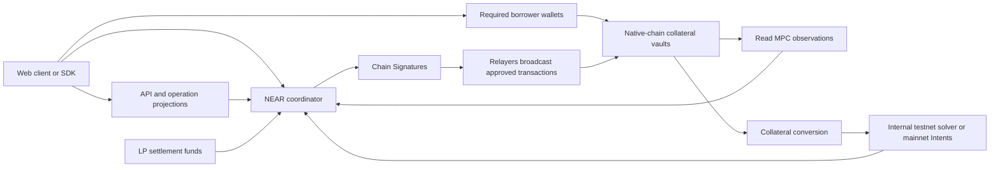
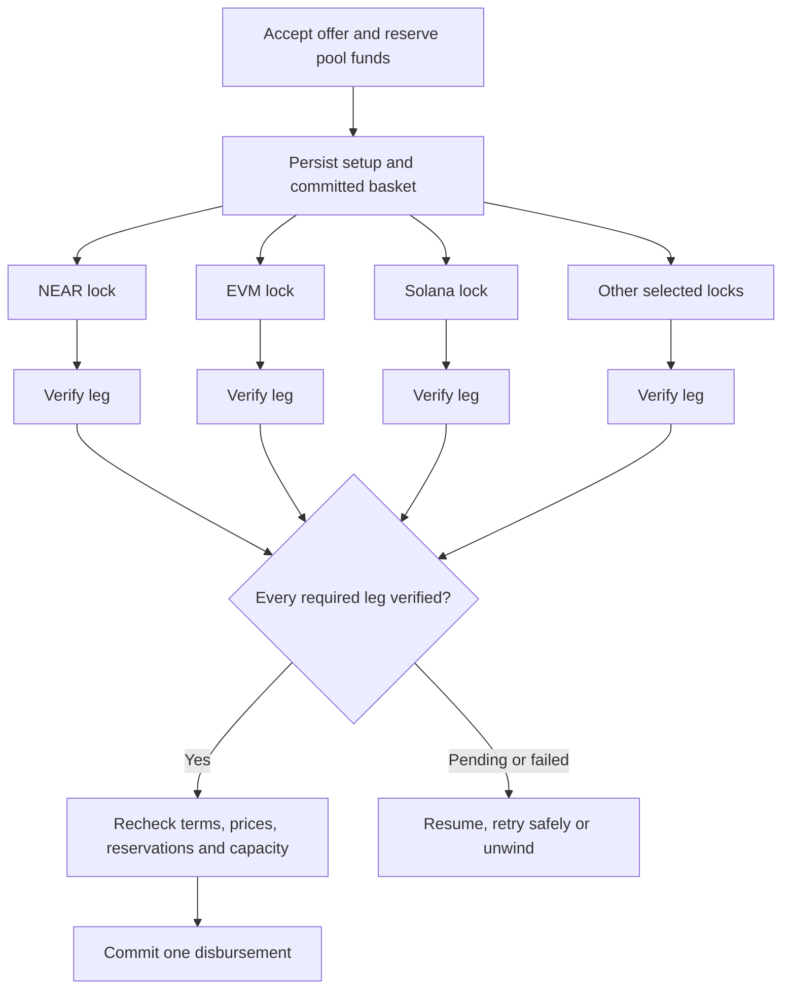

# Kanso — Product and Technical Specification

Version: 0.1  
Date: 24 October 2026  
Status: implementation specification; deployment and validation requirements are identified separately.

## Contents

- [Product, funding and supported chains](#1-purpose): sections 1–3.
- [Architecture, records and valuation](#4-architecture-and-trust-boundaries): sections 4–6.
- [Pools and the borrower lifecycle](#7-pool-policy-offers-and-loan-terms): sections 7–8.
- [Parallel execution, state and custody](#9-parallel-execution-and-durable-state): sections 9–10.
- [Repayment, collateral management and liquidation](#11-repayment-and-conversion-settlement): sections 11–14.
- [SDK, API, server and contracts](#15-sdk-contract): sections 15–18.
- [Client, operations and complete file structure](#19-client-behavior-and-hosting): sections 19–21.
- [Acceptance criteria, implementation gates and sources](#22-verification-and-acceptance-criteria): sections 22–24.

## 1. Purpose

Kanso lets a borrower obtain **one loan against several collateral holdings across wallets, assets and chains**. Collateral remains locked on its original chain. A coordinator on NEAR records the basket, funding terms, debt, repayment authorizations and settlement results.

The borrower has one debt balance and one combined collateral-health calculation. A basket is a contract record with an internal identifier. Kanso does not issue a borrower basket token, basket NFT or universal `bskNEAR` token.

For example, a basket containing $600 of ETH on Arbitrum, $400 of SOL and $500 of NEAR has $1,500 of gross collateral value. At an illustrative uniform 50% borrowing limit, it could support $750 of debt. Combining the holdings does not create additional collateral value. Production borrowing limits depend on each asset and chain's approved risk parameters.

This document defines the target behavior and software boundaries. It does not assert that the contracts, adapters or integrations have already been implemented, deployed or audited.

### 1.1 Product scope

Kanso includes:

- LP-funded lending pools with configurable terms and capacity.
- Basket selection followed by connection of the wallets needed for that basket.
- Funded loan offers, finite loan terms and one pool funding each loan.
- Parallel collateral setup with durable progress, verification and recovery.
- Native-chain collateral custody coordinated from NEAR.
- Combined basket valuation, interest accrual and health monitoring.
- Manual partial or full repayment in the settlement asset.
- Repayment using pledged collateral or another supported wallet asset.
- Optional conditional repayment with a cumulative authorization budget.
- Collateral top-ups, safe excess withdrawals and collateral replacement without closing the loan.
- Partial liquidation, maturity recovery and return of excess proceeds.
- A framework-independent TypeScript SDK, web client, API and background workers.

Kanso does not depend on RHEA/Burrow supplying credit against its vaults. It does not depend on borrowed funds remaining inside trading accounts. LP pool shares are legitimate claims on a common pool; they are separate from the borrower's individually recorded basket.

### 1.2 Non-negotiable invariants

1. A loan cannot fund until every required collateral leg is verified and its funding checks pass.
2. One collateral unit, deposit event or Bitcoin outpoint cannot secure two independent obligations.
3. The borrower cannot unilaterally withdraw collateral while it secures debt or a committed operation.
4. Remote signatures authorize narrowly specified transactions; the backend cannot request arbitrary spending.
5. A signature, submitted transaction or provider success message is not proof of completed delivery.
6. Debt decreases only when the correct settlement asset is received and applied by the coordinator.
7. Each disbursement, repayment, sale and release has one logical identity and an exactly-once accounting effect.
8. Funding reservations, sale reservations and conditional-repayment budgets cannot be double spent.
9. Replacement collateral is verified before the outgoing collateral is released.
10. A cross-chain timeout alone does not establish that a transaction failed or that escrow can be refunded.
11. Database projections and workers cannot override contract custody, debt or authorization rules.
12. A borrower may recover collateral from an aborted, unfunded setup through a defined unwind process.

## 2. Actors and funding

| Actor | Responsibility |
| --- | --- |
| Borrower | Chooses collateral, requests terms, accepts an offer, locks holdings and manages repayment. |
| LP | Supplies the pool's settlement asset and receives pool shares. |
| Pool manager | Configures the pool's permitted rate policy, maximum duration, collateral eligibility and exposure caps within protocol limits. |
| Coordinator contract | Enforces canonical basket, pool, loan, risk, authorization and settlement state on NEAR. |
| Remote vault | Holds native collateral and enforces the authorized controller, operation nonce and spend limits. |
| Read MPC | Supplies authenticated observations of eligible foreign-chain transactions. |
| Chain Signatures | Signs remote transactions that the coordinator has explicitly authorized. |
| Relayer / keeper | Prepares, broadcasts and monitors transactions; its assertions alone do not release funds or change debt. |
| Internal testnet solver | Supplies test settlement liquidity in exchange for approved source assets. |
| Mainnet settlement provider | Routes supported conversions using NEAR Intents under a bounded settlement plan. |

Pool managers do not negotiate each loan manually. They publish policies from which executable offers are generated. A manager may also be an LP. A solver's conversion liquidity is distinct from the LP capital that funds loans.

### 2.1 Settlement asset

The initial debt and pool-accounting asset is **USDC on NEAR**. Each deployment pins the exact NEP-141 contract identifier, decimals, token standard and issuer/bridge identity. A symbol match is insufficient.

Testnet may use a clearly labeled test USDC implementation with matching accounting behavior. Its contract identifier must be recorded after deployment and verified; this specification does not invent an address. Test USDC has no production redemption claim.

The first disbursement destination is the borrower's approved NEAR settlement account. A future option to receive borrowed funds elsewhere must be modeled as a separate routed payout operation with explicit fees and completion evidence. It must not silently change when the loan starts accruing interest.

## 3. Chain and asset scope

The target is **11 chains and 10 native collateral assets**. ETH has two distinct chain locations.

| Chain | Native collateral | Wallet/adapter family | Test environment |
| --- | --- | --- | --- |
| Bitcoin | BTC | Bitcoin | Bitcoin Testnet3 |
| NEAR | NEAR | NEAR | NEAR testnet |
| Solana | SOL | Solana | Solana devnet |
| Base | ETH | EVM | Base Sepolia, chain ID 84532 |
| Arbitrum | ETH | EVM | Arbitrum Sepolia, chain ID 421614 |
| BNB Chain | BNB | EVM | BNB testnet, chain ID 97 |
| Polygon | POL | EVM | Amoy, chain ID 80002 |
| Avalanche C-Chain | AVAX | EVM | Fuji, chain ID 43113 |
| HyperEVM | HYPE | EVM | HyperEVM testnet, chain ID 998 |
| Starknet | STRK | Starknet | Starknet Sepolia |
| Sui | SUI | Sui | Sui testnet |

Ethereum, Optimism, Fogo, Aptos and Abstract are outside this target list. One EVM implementation serves the six configured EVM networks; it still validates each network independently. STRK on Starknet is held through its configured token contract, rather than assuming every chain's collateral is transferred as transaction value.

This table expresses intended product coverage. Each chain remains disabled in the executable catalog until its wallet, deposit, foreign verification, authorized spend, liquidation and release paths pass the acceptance gates in section 22. Incoming Read MPC availability does not prove outgoing transaction-signing compatibility or an implemented Kanso adapter.

### 3.1 Deployment manifest and capabilities

`deployments/testnet.json` records actual deployments and verified network configuration. It contains:

- Coordinator account and code version; settlement-token identity.
- Chain identifiers and network fingerprints, including genesis/checkpoint identity where appropriate.
- Vault/program/package/account addresses and code hashes.
- MPC signer account, public-key/domain configuration and supported request versions.
- Controller derivation paths, signature schemes and authority addresses.
- Oracle feed identities, finality rules, confirmation requirements and fee parameters.
- Adapter capability flags and evidence of the last successful end-to-end validation.
- Settlement-provider availability by asset, network and operation.

The public catalog reports `planned`, `testing`, `enabled` or `paused` per capability. Wallet support, incoming verification, outgoing execution and swap routing are separate capabilities. A chain is borrowable only when the full required path is enabled.

## 4. Architecture and trust boundaries



### 4.1 NEAR as the coordinator

NEAR is the canonical home of pool cash accounting, loan debt, basket commitments, accepted lock records, operation reservations and repayment authorization. Native NEAR collateral is held by the coordinator's native-collateral module. Other assets remain in their chain's approved custody arrangement.

The canonical contract must remain operable through documented direct calls and the SDK when the hosted API is unavailable. Server services improve discovery, preparation, indexing and execution; they do not become an alternative source of financial authority.

### 4.2 Incoming verification

Read MPC is the selected incoming verification path for eligible foreign chains. The coordinator verifies the authenticated response, request identity, chain/network, transaction, finality and extracted data before accepting a lock or remote completion. Nodes observe configured RPC sources; this is an MPC/RPC attestation trust model, not a source-chain light client implemented by Kanso. See the [NEAR MPC implementation](https://github.com/near/mpc).

Each adapter must show that the deployed extractor authenticates all data Kanso relies on. Where a response authenticates a transaction identifier or a commitment rather than the complete application record, Kanso reconstructs that commitment and verifies the supplied event/transaction bytes against it. Unauthenticated RPC fields must never determine custody amounts or recipients.

An indexer can discover a candidate transaction. Only the accepted verification result advances the corresponding contract state. Arbitrary third parties may submit valid evidence without acquiring custody authority.

### 4.3 Outgoing execution

Chain Signatures is the selected outbound authorization mechanism. A Kanso contract requests a signature only after checking the operation's state, policy, amount, recipient, network, transaction encoding and resource reservations. A relayer broadcasts the resulting transaction, and incoming verification establishes completion. NEAR documents the distinction between signing outbound transactions and reading foreign state in its [Chain Signatures documentation](https://docs.near.org/chain-abstraction/chain-signatures).

The contract must construct or fully validate the payload to be signed. Accepting a backend-supplied hash without validating the transaction it represents would give the backend arbitrary custody power and is prohibited.

Derivation paths are domain-separated by Kanso deployment, environment, network and authority purpose. Bitcoin collateral addresses additionally identify the basket/leg. Different chains do not reuse keys merely because they share an address format. The implementation pins supported signer domains rather than assuming a domain number or key remains constant forever.

### 4.4 Conversion and routing

Mainnet conversion uses NEAR Intents where its current asset/network capabilities satisfy Kanso's settlement requirements. Aurora or HOT tooling may assist integration or wallet access, but neither replaces vault permissions, verification or loan accounting. Aurora deployment and Wormhole messaging are not mandatory components of this design.

NEAR Intents currently documents **no testnet deployment**. Kanso therefore uses internal solvers for testnet conversion and tests the mainnet provider separately. This is a provider distinction, not simulated cross-chain collateral custody. See the [NEAR Intents FAQ](https://docs.near-intents.org/resources/faqs).

## 5. Canonical data model

All economic objects are scoped to `deployment_id` and `network`. Hash commitments use versioned, deterministic, length-delimited encoding shared with the Rust contracts. Do not hash arbitrary JSON whose field order or number encoding can vary.

| Record | Essential fields |
| --- | --- |
| Asset | `asset_id`, chain/network, native/token identity, decimals, price feed, eligibility and risk version. |
| Linked account | Account identifier, chain namespace, owner/session binding, signed challenge and permitted purpose. |
| Basket | `basket_id`, owner, revision, ordered leg commitments, lock records and operation reservations. |
| Basket leg | `leg_id`, asset, owner/source account, requested amount, custody location, deposit identity and release recipient. |
| Request | `request_id`, borrower, basket commitment, principal, duration, conditional configuration and request expiry. |
| Offer | `offer_id`, pool, request hash, principal, APR, duration, fees, risk/policy versions, recipients and deadlines. |
| Reservation | Reserved pool cash, accepted offer, setup deadline and lifecycle state. |
| Loan | `loan_id`, pool, borrower, basket, principal outstanding, accrued interest, timestamps, terms and debt state. |
| Conditional authorization | Enabled flag, version, trigger, total/remaining repayment and collateral budgets, execution limits and reservations. |
| Operation | Kind, parent/child identities, expected revision, intent hash, deadlines, state, resources and evidence references. |
| Remote action | Network, authority, exact spend plan, nonce/outpoints/objects, payload hash, signature and broadcast attempts. |
| Settlement | Input reservation, provider quote, escrow/receipt identity, minimum net USDC, recipients, delivery proof and accounting marker. |
| Pool | Manager, immutable identity, cash and reservations, outstanding receivables, recognized losses, shares and policy versions. |
| LP position | Owner, share balance, pending withdrawal claims and deposit/withdrawal operation references. |

### 5.1 Amounts and identifiers

- On-chain amounts are unsigned integer atomic units. JSON transports encode them as decimal strings; SDK computations use `bigint` or an audited fixed-point amount type.
- API schemas never use JavaScript floating-point amounts for token accounting, rates, health or limits.
- APRs and risk factors use basis points. Health is returned in a documented fixed scale, such as parts per million; timestamps use explicit Unix seconds.
- `asset_id` includes the network and token identity. ETH on Base and ETH on Arbitrum can share a price reference while remaining distinct custody assets.
- Only EVM address comparison may apply the appropriate case-normalization rules. NEAR, Bitcoin, Solana, Sui and Starknet identifiers follow their own canonical encodings.
- A deposit uniqueness key includes deployment, network, custody target and the source event/object/output identity. Bitcoin uses at least `(network, txid, vout)`.

### 5.2 Authority and persistence

Contracts own balances, accepted terms, reservations, debt and consumption markers. MongoDB holds searchable projections, user-visible activity and the durable execution journal. Redis/BullMQ schedules work. Neither a job acknowledgement nor a database row is evidence that a blockchain action completed.

Financial transitions emit stable event IDs and record monotonic revisions. Projectors deduplicate events and retain cursors; SDK snapshots expose the canonical revision and last indexed block so stale displays are identifiable.

## 6. Valuation, borrowing capacity and health

### 6.1 Price inputs

Each eligible asset has an approved oracle route with authenticated updates, decimals, a maximum age, a confidence bound and a divergence policy. A backend price is suitable for display and discovery; it cannot, by itself, authorize a loan or collateral release.

The coordinator validates updates or uses a verified on-chain oracle adapter. Exact feed providers and deployed adapters must be selected and demonstrated for all ten assets before production enablement. A missing or stale price disables new borrowing and risk-increasing withdrawals for the affected basket. Repayment, safe deposits and reconciliation can continue. Liquidation requires a valid price or an explicitly configured, independently bounded fallback; it must not trade against an arbitrary stale quote.

USDC is the loan denomination. If collateral prices arrive in USD, the oracle adapter also applies the approved USD/USDC conversion or a disclosed, bounded peg assumption with a circuit breaker. A material USDC depeg cannot be hidden by equating USD and USDC indefinitely.

### 6.2 Formulas

For accepted, eligible collateral leg `i`:

```text
q_i = locked atomic amount / 10^asset_decimals
p_i = conservative price in settlement-asset units
V_i = q_i × p_i
L_i = origination LTV for this asset and chain
T_i = liquidation threshold for this asset and chain

gross_collateral_value = Σ V_i
borrowing_capacity = Σ (V_i × L_i), subject to concentration/cap rules
liquidation_value = Σ (V_i × T_i), subject to concentration/cap rules
debt = outstanding_principal + accrued_interest + due_disclosed_fees
health_factor = liquidation_value / debt
```

`0 < L_i < T_i < 1` for ordinary volatile collateral. A deployment may choose stricter values. At origination, principal plus initially due fees and the pool's explicit required interest buffer must fit borrowing capacity and other pool limits. The buffer is a capacity check, not interest already charged. Subsequent health uses actual accrued debt. A basket becomes price-liquidatable when its health factor is at or below `1`, according to the valid oracle snapshot.

Zero debt is represented as `debt = 0` with health `null`/unbounded, rather than division by zero. The API includes the debt state/reason so the UI distinguishes an unfunded setup from a repaid loan. Collateral value and capacities round down; debt obligations round up according to one documented atomic-unit policy. Carry interest remainders across accrual checkpoints so repeated calls cannot create extra interest through rounding.

An asset-specific weight changes its contribution to the **one basket calculation**. It does not create separate loans or separate liquidation triggers for ETH, SOL and NEAR.

### 6.3 Example

With the earlier $1,500 basket, a hypothetical common 50% origination LTV yields $750 capacity. If all legs had a hypothetical 70% liquidation threshold, the liquidation value would be $1,050 and health at $750 debt would be `1.40` before interest. A price decline to $1,000 gross value at that same threshold would produce `700 / 750 = 0.9333…`, making the basket eligible for liquidation.

These figures demonstrate the calculation. They are not calibrated launch parameters, and actual weights may differ by asset and chain.

### 6.4 Exposure and pending operations

Risk policies also constrain chain/asset concentration, minimum economically recoverable collateral, pool exposure, transaction costs and available conversion liquidity. Different locations of ETH can have different delivery and execution costs even when they use the same market price.

Only verified collateral contributes to borrowing capacity. A pending top-up or replacement cannot support a withdrawal. Collateral reserved for sale or release is unavailable to another operation. Financially conflicting operations serialize against the basket revision.

During a sale, track three separate amounts: assets still in custody, assets committed/in transit, and settlement funds already received. Do not count the same source collateral and its escrow backing twice. An exclusively earmarked, irrevocably secured USDC escrow can appear as a separately identified recovery claim during delivery; it is not repaid debt or lendable pool cash. Providers without equivalent backing require a bounded in-flight exposure limit. Risk-increasing changes remain blocked while that exposure is unresolved.

## 7. Pool policy, offers and loan terms

### 7.1 Pool configuration

The manager configures:

- Fixed APR or a deterministic rate policy whose evaluated APR is fixed in each accepted offer.
- Minimum/maximum loan size and maximum duration.
- Eligible assets/chains within the protocol's allowlist.
- LTVs, liquidation thresholds and exposure caps no weaker than protocol bounds.
- Liquidity reserve requirements, setup reservation duration and withdrawal policy.
- Explicit origination/protocol fees, liquidation incentives and execution-cost caps, if any.
- Maturity grace period and the rules for realizing unrecovered debt.

There is no implicit commitment fee, reservation fee or rollover fee. Any charge must appear in the offer's signed commitment and the borrower's cost summary. No policy change may retroactively alter an active loan's rate, maturity, collateral claim or agreed authorization. Emergency restrictions may pause new risk; migration or custody changes need their own controlled procedure.

### 7.2 Offer discovery and acceptance

The API evaluates the selected basket, requested terms, oracle availability and pool capacity. It returns offers backed by currently available pool liquidity. The coordinator independently re-evaluates each accepted offer against its versioned pool policy and authenticated inputs; an API-generated hash or signature alone cannot override the rate, eligibility or exposure limits. An unaccepted offer remains subject to a short expiry and a final capacity check; it is not an indefinite cash reservation.

Acceptance atomically checks the committed terms and reserves principal plus any explicitly reserved payout cost in the NEAR pool. Once this reservation succeeds, the offer is a firm setup commitment until its deadline, subject to its explicit collateral and safety conditions. Competing acceptances cannot reserve the same cash.

An offer binds the borrower, payout account, basket/asset amounts, pool, principal, APR, duration, fees, policy/risk versions, liquidation terms, conditional authorization hash, setup expiry and price constraints. Material changes require a new commitment. A borrower is never silently funded against a smaller partial basket.

Reservation extension requires an explicit permitted action and capacity check. A stopped or expired setup releases pool capacity only when the coordinator has made funding impossible for that reservation. Any already locked collateral follows the unwind flow.

The setup deadline must accommodate the chosen chains' finality requirements, wallet interaction and proof latency. A Bitcoin-containing basket cannot be advertised with a deadline shorter than its configured viable confirmation path. Display the deadline and estimated stage times before acceptance; do not silently extend reserved LP liquidity indefinitely.

### 7.3 Interest and maturity

The initial interest convention is fixed-rate, simple interest, Actual/365 using elapsed seconds:

```text
interest_increment = principal_outstanding × apr_bps × elapsed_seconds
                     / (10_000 × 31_536_000)
```

Accrue before each principal change, preserve the calculation remainder, and then update the principal basis. Interest does not compound in this convention. Apply payments to disclosed due fees, accrued interest and then principal. Early repayment pays accrued interest through repayment, with no unadvertised full-term interest charge.

In this version, `principal_atomic` is the exact USDC payout amount. Any origination charge is separately disclosed as a fee due on the loan, excluded from the interest-bearing principal, and included in capacity/health checks. It must not also be withheld from the same payout or counted twice. Zero fees remain a valid pool configuration.

`started_at` is the coordinator's canonical finalization time when successful disbursement is established, and `matures_at = started_at + agreed_duration`. Record it exactly once. A pending or failed transfer does not accrue active-loan interest. If a delayed accounting callback needs recovery, the recovery transition establishes the recorded start; the loan is never silently backdated from an untrusted worker timestamp.

There is no automatic rollover. At maturity the loan becomes `due`; after the committed grace period it becomes `defaulted` and eligible for recovery even if its collateral health remains above 1. The accepted offer specifies whether the same APR continues through grace and recovery; this version uses the same simple APR until repayment or contractual write-off, without an extra penalty APR.

Price liquidation can occur before maturity. Maturity recovery sells only what is needed for the amount owed and permitted costs. Remaining collateral and surplus belong to the borrower. A deficit is recorded as pool loss under the published loss policy; Kanso does not imply an undisclosed insurance guarantee.

### 7.4 LP accounting

Pool shares represent proportional claims on the same pool's net assets. Pool NAV includes cash and properly recognized loan receivables, less recognized losses and liabilities. Origination reservations reduce available cash, rather than creating a second asset. Conditional solver escrow is not LP yield or available pool cash.

Share mint/burn math uses conservative rounding and protection against first-deposit/donation manipulation. Deposits are credited only after verified token receipt. A withdrawal request reserves or escrows the requested shares; a claim burns them only against a settled payout under the configured withdrawal policy. Outstanding loans can make withdrawal requests pending. The UI must distinguish share value, available withdrawal cash and realized LP return.

The contract recomputes share conversion at the policy's declared pricing checkpoint, prevents withdrawal claims from outranking already reserved obligations, and records cancellations exactly once. An advertised loan APR is not a guaranteed LP APY.

## 8. Borrower flow

1. **Choose the basket.** Select eligible asset/network combinations and desired amounts.
2. **Connect the needed wallets.** Resolve only the selected chain families. Discover balances and verify source-account ownership. Establish the coordinator identity/session as required; do not demand every supported wallet upfront.
3. **Choose borrowing terms.** Enter principal, duration, payout account and optional conditional repayment.
4. **Receive offers.** Show available pools, fixed APR, total cost assumptions, maturity, health estimates and collateral requirements.
5. **Accept an offer.** Commit the exact terms and reserve pool funds on NEAR. Create the setup operation and child lock operations.
6. **Lock collateral.** Request the necessary source transactions. Run independent legs concurrently where wallets and chain resources permit.
7. **Verify every lock.** Wait for the configured finality and accepted incoming evidence. Show independent progress for each leg.
8. **Fund the loan.** Recheck the funding barrier and execute one disbursement.
9. **Manage one loan.** Show debt, accrued interest, maturity, combined health, collateral locations, conditional authorization and pending actions.
10. **Repay or recover.** Apply actual settlement receipts. Release eligible collateral through separately tracked outgoing operations.

Ownership linking uses a replay-protected challenge binding deployment, borrower identity, chain, source account, purpose, nonce and expiry. Linking a wallet does not transfer custody or grant unlimited transaction authority. A designated borrower identity and each source owner approve the terms appropriate to their role.

The coordinator identity needs a valid NEAR authorization path: a NEAR wallet, or an implemented and reviewed delegated/account-abstraction session. Connecting only an EVM or Solana wallet does not, by itself, create that path. The client resolves this requirement explicitly while avoiding unrelated collateral-wallet prompts.

## 9. Parallel execution and durable state

Cross-chain operations are asynchronous workflows. Kanso does not pretend that transactions on 11 networks form one atomic transaction. Parallel execution reduces avoidable waiting; a funding barrier preserves the economic invariant.

### 9.1 Setup fan-out and funding barrier



The operation exists on the coordinator before any deposit instruction is issued. Each child binds `setup_id`, `leg_id`, `loan_id`, basket commitment and its unique deposit identity. Locks may be verified in any order.

The final funding check requires all required legs, accepted source finality, correct controller/custody, current price validity, sufficient borrowing capacity, unchanged committed terms, a usable payout account, an unexpired reservation and no abort marker. A single compare-and-transition on the coordinator wins funding; duplicate workers only observe the result.

### 9.2 Concurrency boundaries

| Work | Execution rule |
| --- | --- |
| Balance reads, fee estimates, offer discovery | Parallel with bounded per-provider concurrency. |
| Independent wallet families | Lock submissions may run concurrently after user approval. |
| Multiple actions through one wallet | Respect the wallet's prompt behavior; allow serialized prompts without blocking unrelated confirmation monitoring. |
| EVM transactions | Queue nonce allocation by `(network, sender)`. The same address on two chains has independent queues. |
| NEAR transactions | Serialize nonce assignment per access key, or use explicitly managed separate keys. |
| Bitcoin transactions | Reserve UTXOs and change destinations before building/signing; incompatible spends serialize. |
| Sui transactions | Reserve owned objects/gas coins; refresh object versions before a new attempt. |
| Solana transactions | Track recent blockhash validity, signatures and any durable nonce; expired messages need reconciliation before rebuilding. |
| Starknet transactions | Serialize account nonces and validate the configured account/signature path. |
| Finality waiting and Read MPC requests | Independent legs run concurrently, subject to provider and signer limits. |
| Loan financial changes | Commit against one authoritative loan/basket revision; do not approve conflicting actions from parallel stale snapshots. |

Use bounded workers and `Promise.allSettled`-style collection for independent legs so one rejection does not discard other results. Do not hold a database transaction open while waiting for a wallet, RPC, signature or remote confirmation.

Top-ups to independent legs may progress concurrently. Release/sale commitments serialize against the loan's reservations and expected revision; once committed, remote execution can proceed in parallel for disjoint resources. Two simultaneous withdrawals must not each pass a health check that ignores the other.

### 9.3 Separate state machines

One status enum must not mix loan debt, setup progress, wallet prompts and remote transaction delivery.

**Loan debt state**

```text
pending_funding → active → due → defaulted
pending_funding → cancelled
active / due / defaulted → repaid
defaulted → written_off      (only after the defined recovery/loss process)
```

Liquidation is an operation on a debt-bearing loan, not a reset of its maturity state. Custody cleanup is tracked separately. `repaid` can therefore coexist with `release_pending`. “Closed” is derived from completed repayment or finalized loss recognition, with no unsettled custody/settlement obligations. A written-off loan retains its unrecovered amount in a separate historical deficit record; that amount is not represented as repaid cash or a performing pool receivable.

**Setup state**

| State | Meaning / next action |
| --- | --- |
| `reserved` | Offer accepted; pool cash reserved; no assumption of completed locks. |
| `locking` | Child legs may be awaiting signatures, submitted, verifying or verified. |
| `ready` | Every required leg verified; funding recheck may proceed. |
| `funding` | Single disbursement committed; transfer outcome must be reconciled. |
| `funded` | Disbursement success established and loan active. |
| `aborting` | Funding disabled for this setup; discover/recover all completed or late locks. |
| `unwinding` | Approved releases are in progress. |
| `aborted` | No debt/disbursement exists and all known collateral obligations resolved. Late deposits remain recoverable by the archived setup identity. |

`ready → locking` is allowed only when a pre-funding verification becomes invalid or expires. `reserved/locking/ready → aborting` is allowed before disbursement commitment. A setup already in `funding` cannot be cancelled until the transfer is proven unsuccessful or reconciled successfully.

**Lock leg state**

```text
planned → awaiting_wallet → prepared → submitted → confirming → verifying → verified
```

`prepared` means the intended transaction and resource allocation are persisted, not necessarily signed. A signed payload and broadcast attempt are journaled before an external send whenever the wallet API permits. For wallet-managed broadcasting, persist the operation intent before asking the wallet, then record its returned transaction identity immediately.

`action_required`, `retry_wait`, `broadcast_unknown` and `reorged` are explicit recovery conditions with a `resume_state`, rather than erasing the prior checkpoint. Rejection before signing returns to a resumable user-action condition. A reorg before accepted finality invalidates the candidate proof. A reorg beyond the configured acceptance threshold triggers exposure reconciliation and a chain pause; the record must not silently remain valid.

Custody disposition is a separate field: `locked`, `sale_reserved`, `release_reserved`, `in_transit`, `delivered` or `released`. A verified lock record remains auditable after its collateral has been released.

**General operation state**

```text
created → prepared → committed → executing → verifying → completed
```

Before commitment, an operation may become `cancelled`. After commitment, use `retry_wait`, `reconciling` or a specifically proven compensation flow. “Failed” is terminal only when it is established that no unresolved asset movement or liability remains. An API timeout is not a terminal financial result.

### 9.4 Partial completion, cancellation and late deposits

If NEAR and SOL locks succeed while an EVM wallet is disconnected, persist those two successes and resume only the unresolved leg. Do not ask the borrower to lock everything again. No loan funds until the original basket is complete.

If the borrower cancels or the reservation expires before funding commitment:

1. Atomically disable funding and mark the setup aborting on NEAR.
2. Reconcile all submitted/unknown legs, including transactions that arrive after cancellation.
3. Authorize release only to each committed owner/refund recipient and only for the amount actually locked.
4. Broadcast and verify each release independently; expose outstanding source-chain actions.
5. Release pool cash once funding is impossible; retain the setup tombstone and recovery entitlement for late deposits.

Do not rely on a global atomic rollback. An expired deposit authorization must not strand assets: a late transfer is either rejected at source or becomes a recoverable, non-borrowable deposit tied to the original setup. It cannot reactivate the cancelled loan.

### 9.5 Retries, nonces and signatures

Every mutating SDK/API request has an idempotency key bound to its canonical payload. Reusing the key with a different payload is rejected. The key indexes the same logical operation across retries, not merely one HTTP request.

An unknown broadcast is reconciled by transaction hash/signature, sender nonce, spent outpoints or object versions before issuing an alternate spend. Fee replacements and rebuilt transactions are attempts of the same operation with an approved bounded change, not additional payment instructions.

Remote vault commands include operation IDs, per-lock spend nonces, amounts, destinations and applicable execution deadlines. A consumed command cannot execute again. Spending a different part of a basket does not require one global vault nonce that unnecessarily blocks every other loan.

A signed transaction may remain executable after an application timeout. Before releasing a reservation or refunding escrow, prove that the old transaction is finalized, invalidated, or cannot execute under source-chain rules. Bitcoin transactions have no general application expiry; reserved inputs remain encumbered until their spend is resolved or an invalidating conflicting spend is confirmed. Signature issuance is therefore a commitment boundary.

### 9.6 Restart and worker recovery

Persist the expected revision, prepared payload, resource reservations, signer request ID, signed transaction where available, broadcast attempts, source observations and accounting marker. Workers claim bounded leases and retry with backoff. A new worker can resume from these checkpoints after process failure without re-creating the financial operation.

Use an outbox pattern to schedule follow-up work after database changes. Contract reconciliation remains authoritative if the process crashes between a blockchain write and a database update. Queue delivery is at least once; application effects are idempotent. Poisoned or ambiguous operations enter an explicit reconciliation queue with visible reasons.

Database journal updates use compare-and-set on `(operation_id, revision)` and unique indexes for idempotency identities, canonical source events and allocated remote resources. Remote attempts retain their payload hash, nonce/outpoints/objects and supersession relationship; replacing an attempt must not erase an earlier executable signature. Persist immutable transition history separately from the current projection so recovery can explain which commitment actually won.

## 10. Native collateral custody

### 10.1 Shared vault requirements

Each vault accepts deposits identified by the coordinator's committed setup and records borrower/basket/leg identity, asset, amount and controller. The contract permits only approved native assets/token identities. The depositor cannot install an alternate withdrawal key or redirect the loan's liquidation authority.

The same custody implementation may accept separately tagged `payment` locks for external-asset repayment. They bind a payment operation and payer/refund identity rather than becoming pledged basket collateral. A payment lock never increases borrowing capacity. Payment asset eligibility is a distinct catalog capability, with its own token identity and transfer behavior checks.

Every release or sale validates the designated MPC controller, command identity, lock nonce, available amount and recipient. Commands distinguish a borrower release from a sale delivery. Arbitrary contract calls, token approvals and delegate execution are outside the vault's normal surface.

The NEAR coordinator validates the full command before signing. Source vaults enforce replay protection and custody limits locally. Neither component substitutes for the other. Transfer fees, rent, storage deposits and source gas are accounted separately from collateral quantities; gas sponsorship is optional and must not imply a free, unlimited execution guarantee.

### 10.2 NEAR

Native NEAR deposits attach NEAR to the configured lock method. Storage obligations and reserved gas/storage balances are excluded from borrowable collateral. Native release methods obey the same operation and health rules as remote release. NEP-141 settlement funds, native collateral and operational reserves are distinct ledger entries even if held by one account.

### 10.3 EVM networks

Use `CollateralVault.sol` for the six configured networks. Native ETH/BNB/POL/AVAX/HYPE deposits use payable lock methods with explicit basket/leg identifiers. If a network represents an eligible asset through a token contract, the manifest pins that exact representation and the vault measures actual receipt.

The authority is the deployment/network-specific Chain Signatures controller. Authorized transactions call narrowly defined vault functions with replay-protected commands. Enforce checks-effects-interactions, reentrancy protection and safe failure handling. Repeated releases cannot exceed the remaining locked balance. Test forced native transfers and unsolicited deposits so they cannot be misattributed to a basket.

### 10.4 Solana

Use a custody program with deterministic vault accounts/PDAs and explicit basket/leg records. A borrower deposit transfers SOL under the program's custody. The approved MPC-controlled Ed25519 authority authorizes release instructions; the borrower alone cannot move vault lamports.

Exclude rent-exempt reserves from usable collateral and validate account ownership, instruction accounts, program ID, destination and signer. Confirm the specific finality/extractor path for successful program execution, rather than accepting a transaction signature or a log string from any program.

### 10.5 Sui

Use a Move vault whose objects bind collateral coins to a basket and the approved controller. Borrower-held ownership of a coin must not permit bypassing the vault's repayment conditions. Define the shared/owned object model explicitly, including capability custody, coin splitting/merging and gas-coin separation.

Incoming verification must authenticate the package/module, successful effects, created/consumed objects, amounts and finality. Prevent duplicate counting after object merges, object-ID changes or replayed transaction effects.

### 10.6 Starknet

Use a Cairo collateral vault and a compatible controller account. STRK is identified by the configured token contract. Validate account execution, vault method/arguments, amounts, nonce and successful finalized events.

Incoming Read MPC support is not evidence that the signer can produce Starknet's native account signature scheme. Before enabling STRK, implement and validate a controller account that securely accepts a currently supported MPC signature scheme, or prove an appropriately supported native signing path. This is a named implementation gate, not an assumed property of the Chain Signatures integration.

### 10.7 Bitcoin

Bitcoin uses **MPC-controlled native BTC custody**, not a Bitcoin smart contract folder and not automatic conversion into nBTC.

For each basket leg, derive a network-separated custody address controlled by the NEAR coordinator's permitted MPC requests. The borrower signs a deposit transaction from their wallet. Accepted outpoints become collateral only after the configured confirmations, authenticated transaction inclusion and output validation.

The Bitcoin adapter and NEAR collateral module must:

- Parse raw transactions and verify the computed txid against the authenticated transaction identity.
- Check output index, script/address, exact satoshi amount and custody derivation binding.
- Reject reuse of any accepted outpoint and track later spends/change.
- Validate canonical block/confirmation evidence and the request's network fingerprint.
- Construct authorized spends with explicit inputs, solver/borrower outputs, change outputs and maximum fee/fee rate.
- Reserve UTXOs before signing; attribute change to the same collateral obligation until reassigned through a verified operation.
- Support safe fee replacement/recovery without signing an unrestricted alternative spend.
- Enforce dust/minimum-economy limits and distinguish fees paid from BTC from separately funded fees.

The inspected MPC Bitcoin implementation checks confirmation depth and canonical block identity, and its extractor enum exposes `BlockHash`. It does not return a ready-made Kanso output-amount proof. Kanso must bind the authenticated request's txid to its own parsed transaction bytes and verify the outputs/accounting above. The consulted file blob is `b1848fc095bbbec042425a6756b867071bc7f669`; pin the compatible deployed MPC version and response schema during implementation. See the [Bitcoin inspector source](https://github.com/near/mpc/blob/main/crates/foreign-chain-inspector/src/bitcoin/inspector.rs).

The selected test environment is **Bitcoin Testnet3**, corresponding to Bitcoin Core's `chain: "test"`; Testnet4 and signet are separate networks. Before accepting deposits, independently pin/check the expected network fingerprint and live MPC provider mapping. Previously observed provider behavior is not a permanent deployment guarantee. Bitcoin Core documents chain identification in [`getblockchaininfo`](https://bitcoincore.org/en/doc/30.0.0/rpc/blockchain/getblockchaininfo/).

Bitcoin wallet selection, transaction/PSBT construction and UTXO handling live in `packages/sdk/src/adapters/bitcoin/`. Custody policy and output verification live in `contracts/near/src/collateral/bitcoin.rs` and `mpc.rs`. Broadcasting/reconciliation lives in the server's collateral feature.

## 11. Repayment and conversion settlement

### 11.1 Repayment inputs

| Mode | Source | Borrower interaction | Debt accounting |
| --- | --- | --- | --- |
| Direct USDC | Borrower's NEAR settlement balance | Approve/send the exact token through the repayment entry point. | Apply verified token receipt immediately under the payment allocation rule. |
| Other wallet asset | A supported external wallet holding | Accept a bounded conversion quote and sign the source payment. | Apply only net USDC received by the coordinator. |
| Pledged collateral | An existing locked basket leg | Accept a quote, or use a valid conditional/liquidation authorization. | Apply only net USDC received after the approved delivery/settlement conditions. |

A remote USDC token with another contract/network identity is a routed payment input, not automatically the coordinator's accounting asset. The catalog must expose whether a particular source asset can be used for repayment independently of whether it can be used as collateral.

Initial other-asset payment routes can use the supported native holdings where conversion is enabled. Additional tokens require explicit payment adapters and verified receipt/refund behavior; “pay with another asset” does not mean accepting arbitrary token contracts.

### 11.2 Settlement plan

Every executable plan binds:

- Deployment, borrower, loan and operation identity.
- Provider and signed quote identity/version.
- Source asset/network, custody/source account and input reservation.
- Maximum source amount, minimum net USDC and repayment target.
- Exact solver/deposit address and final USDC receiver.
- Allowed source network fee, conversion cost and slippage bounds.
- Quote acceptance deadline, execution conditions and provider recovery rules.
- Source change/refund recipient and settlement-surplus recipient.
- The accepted authorization version and maximum debt reduction.

Prefer exact-output quotes for a known repayment amount, subject to a maximum source spend. A quote expiring before commitment may be refreshed without moving assets. Changing the input bound, recipient or minimum output requires a new authorized plan.

Debt can accrue while a quote is pending. For full repayment, quote a bounded maximum amount through a deadline and refund excess after applying the actual debt. A quote shortfall leaves a visible remaining debt; it must not mark the loan closed. An independent payment received while a sale is committed cannot invalidate the solver's funded delivery contract: reconcile the incoming amount and return any resulting surplus to its rightful owner.

### 11.3 Internal testnet solver protocol

The internal solver runs funded wallets on the selected test networks and a test USDC balance on NEAR. It provides real test-asset conversions through the following protocol:

1. The solver issues a bounded quote committing source asset/amount, net test USDC, recipients, expiry and operation identity.
2. The borrower or existing on-chain authorization accepts it. Kanso validates and reserves the specific input resources.
3. The solver transfers the quoted USDC into the coordinator's settlement escrow. The token receiver validates the exact asset and escrow identity.
4. Kanso marks the settlement funded and commits the source delivery. No source spend may be signed before escrow is actually funded and exclusively reserved.
5. The wallet or MPC-controlled vault delivers the source asset to the committed solver address.
6. Read MPC establishes the required source-chain completion. Native NEAR input uses its native contract receipt path.
7. In one coordinator accounting transition, consume escrow, credit the pool, allocate the repayment and mark the settlement applied. Excess is recorded for refund.

```text
quoted → accepted → input_reserved → escrow_funded
       → delivery_committed → delivery_submitted → delivery_verified → applied
```

Before source-delivery commitment, cancellation can release input reservations and refund solver escrow after proving that no spend authorization remains executable. After commitment, an ambiguous transfer enters `reconciling`; neither side receives an automatic timeout windfall.

The quote/escrow is a specific obligation: the solver cannot withdraw escrow after a matching source delivery, and Kanso cannot keep both the undelivered source asset and solver escrow. Expiry governs new acceptance/commitment. It does not erase an already executable signed transaction. Refunds require evidence that the source delivery did not and can no longer happen, or the protocol's explicit compensated recovery outcome.

For external wallet input, the borrower deposits to an operation-specific Kanso payment lock/custody address. Kanso forwards that input to the solver only under the funded, committed settlement plan. This prevents a late wallet broadcast from transferring assets directly to a solver whose escrow has already been refunded. The payment deposit must match the accepted plan and never enters the loan's collateral valuation. Cancelled or excess deposits remain refundable through verified custody operations, with any permitted network fee disclosed.

### 11.4 Mainnet NEAR Intents provider

Implement a separate provider against NEAR Intents' actual supported quote, deposit, execution, withdrawal and refund interfaces. Do not assume the internal solver's custom escrow sequence is the Intents API or that every target collateral asset is a currently supported conversion route.

The provider must produce a verifiable destination receipt of the exact NEAR settlement token, bind refunds to a Kanso-controlled address for pledged collateral, and document the interval in which source custody has moved but settlement is unfinished. Kanso enforces maximum source spend, minimum output and maximum in-flight exposure at its own commitment boundary.

Provider status helps operations monitoring. Only the canonical USDC receipt and its loan/operation binding authorize debt reduction. Provider refunds restore a spendable collateral balance only after source delivery back into approved custody is verified. External wallet refunds go to the payer's committed recipient.

If a route cannot meet the required custody, recipient, refund or execution constraints, the catalog disables that route. This does not disable direct USDC repayment or unrelated supported collateral flows.

### 11.5 Shared accounting and surplus

`settlement_id` and the accepted receipt identity are consumed exactly once. A replayed callback, duplicate token event or retried worker cannot credit a pool twice. Escrow balances, applied repayments, refundable funds and provider liabilities occupy separate ledger accounts.

For direct payer-USDC transfers, unused tokens can be returned through the token standard's resolver, with only the used amount applied. For a funded solver quote or provider sale output, do not blindly return surplus to the token sender: the plan may establish that those proceeds belong to the borrower/payer. Record that refund liability and pay the correct recipient. The same amount cannot be both returned through the FT resolver and recorded for a second refund.

Pool lenders normally receive USDC. Giving volatile collateral directly to LPs would be a different, explicitly agreed in-kind settlement product and is outside this version.

For a pledged-collateral sale, unsold collateral remains in its basket. Sale proceeds above the actual debt and authorized costs are refundable to the borrower. For external wallet repayment, unused input/output belongs to the payer specified in the payment plan. Refunds themselves are durable transfer operations; an unsuccessful refund remains a liability and cannot disappear from accounting.

## 12. Conditional repayment

Conditional repayment is **optional and off by default**. Turning it off does not disable contractual liquidation, interest accrual or maturity recovery.

The first version has one clear authorization per loan rather than a generic rule engine:

```ts
type ConditionalRepayment = { enabled: false } | {
  enabled: true;
  trigger_health_ppm: string;
  target_health_ppm: string;
  max_total_repayment_atomic: string;
  max_collateral_spend: Array<{
    asset_id: string;
    max_total_atomic: string;
  }>;
  max_execution_cost_bps: number;
  max_execution_cost_atomic: string;
  expires_at?: number;
};
```

The trigger is the **combined basket health**. It must sit above liquidation eligibility, with a validated margin appropriate to the deployment. The target must be above the trigger. A keeper may sell only enough approved collateral to move toward the target or exhaust the remaining budget. Actual execution remains subject to quote availability, fees and transaction completion.

`max_total_repayment_atomic` is a cumulative loan-authorization budget, not an allowance that resets every time the health condition is observed. Each collateral entry also caps cumulative atomic input spend. Execution costs must satisfy both the absolute and proportional limits and include the quote's conversion charges plus any borrower-funded network costs. Enforce debt/repayment ceilings and input caps independently.

The contract stores original limits, consumed amounts and reservations. Before committing an execution it reserves the worst-case repayment/input/cost budget. After settlement it consumes actual amounts and releases only safely unused authorization. Retries reuse the same reservation.

Updates preserve lifetime consumption and outstanding committed reservations. A new total cap cannot fall below the corresponding consumed-plus-reserved amount. Disabling may prevent additional use without invalidating reservations already committed. A new version does not provide a fresh copy of the original allowance.

The borrower can enable, pause or update the authorization through an authenticated on-chain action. An absent configuration means never configured; `enabled: false` means disabled/paused, with history and already consumed budget retained. Re-enabling does not reset spending. Raising limits or creating a new version explicitly shows both previous consumption and the new remaining allowance.

Pausing prevents new commitments. A settlement already committed may finish under its committed version. Once liquidation has reserved the relevant collateral, conditional repayment cannot race it for the same resources. Keepers prefer the least costly eligible execution under the authorization; there is no standing “sell NEAR first” product rule.

Example: authorize up to **100 USDC total** of conditional repayment, from selected collateral within explicit input/cost caps. After 40 USDC is applied, at most 60 USDC remains unless the borrower deliberately increases the authorization. The UI shows enabled state, trigger, remaining budget, reservations, last action and pause/update controls.

## 13. Collateral management

### 13.1 Top up

Create a top-up operation tied to the loan and new/existing leg. Deposit and verify the added amount before increasing effective collateral. Multiple independent top-up legs may run concurrently. Unsolicited transfers are not silently counted as collateral; associate or refund them through a verified recovery path.

### 13.2 Withdraw excess

The borrower requests an exact asset amount and recipient. The coordinator accrues debt, values the basket, subtracts every pending outflow/reservation, and checks the agreed withdrawal safety floor and borrowing-capacity rule. It reserves the outgoing amount before signing.

Recheck immediately before irreversible authorization using valid prices and the latest revision. Once a remote command is signed, count the amount as committed outflow even if it has not yet moved. A subsequent price change does not make that signature disappear. Bound per-operation exposure and avoid issuing more risk-increasing commands while the previous withdrawal is unresolved.

### 13.3 Replace without repaying

Replacement is one parent operation with incoming and outgoing child legs:

1. Commit the requested replacement and safe failure/refund recipients.
2. Lock incoming collateral, in parallel if several incoming legs are independent.
3. Verify all required incoming amounts and recompute combined capacity/health.
4. Atomically reserve the outgoing amount against the latest basket revision.
5. Authorize, deliver and verify the outgoing release.
6. Finalize the new basket revision and clear operation reservations.

The original debt and maturity stay in place. If the new collateral fails to arrive, the old collateral remains locked. If incoming collateral arrives but the outgoing release cannot be authorized safely, keep the replacement pending and offer a safe unwind of the added collateral if the original basket still suffices. After an outgoing spend is committed, reconcile that spend before undoing the replacement.

## 14. Liquidation and default recovery

### 14.1 Trigger and authorization

Liquidation is triggered by the combined basket's valid health calculation, or by default after the maturity grace period. A keeper may propose a sale; the coordinator independently verifies eligibility, remaining debt, price freshness, collateral availability, quote bounds and operation caps.

The borrower need not cooperate with a valid liquidation. Vault custody and MPC authority must permit the approved sale even if all borrower wallets are disconnected.

### 14.2 Partial recovery

Prefer a partial sale sufficient to restore the configured recovery target, subject to execution economics and available collateral. Estimate the **post-sale** basket and debt, including fees, interest and any disclosed liquidation incentive; a sale removes collateral as well as reducing debt.

For a simplified single-weight example, removing collateral worth `x`, applying net debt repayment `r`, and using liquidation threshold `T` produces:

```text
post_health = (current_liquidation_value - T × x) / (current_debt - r)
```

Use the actual selected leg's weight, caps and rounding in production. A sale is not automatically beneficial just because it brings in cash. Reject an avoidably damaging plan or choose a larger/default recovery according to the agreed policy.

Execution selects available, eligible collateral based on attainable net proceeds, risk repair and costs. Basket-wide valuation does not require selling every asset proportionally. There is no borrower-defined asset sale priority in this version. Conditional repayment can restrict its authorized inputs; contractual liquidation retains the recovery rights disclosed in the offer.

### 14.3 Settlement and residual debt

Liquidations use the same bounded settlement pipeline as collateral repayment. Escrow or a validated provider plan precedes source delivery; actual USDC application reduces debt. The liquidation incentive and costs are explicit, capped and included in the borrower's accounting.

Do not promise that an oracle quote guarantees source-chain liquidity or delivery. If one route is unavailable, the coordinator may use another eligible basket leg when that approved sale can repair or recover the combined position. Such a sale does not settle the unavailable leg's outstanding remote operation.

After debt reaches zero, stop new recovery commitments, finish already committed obligations, return settlement surplus and release remaining collateral. If all recoverable collateral is exhausted, recognize the remaining debt/loss through the pool's defined write-off process. Do not continue valuing an unrecoverable balance at par or imply that a backend status update erased the economic loss.

## 15. SDK contract

Package: `@kanso/sdk`. Shared runtime schemas live in `@kanso/schema`; generated contract interfaces and verified deployment metadata live in `@kanso/bindings`.

### 15.1 Design rules

- Framework-independent TypeScript, usable in browsers and Node.
- Domain handles for requests, loans, pools, collateral, repayments and operations.
- Read-only usage without an already connected wallet.
- Lazy wallet resolution by needed chain/account capability.
- Public snake_case method/options naming for a consistent API; no duplicate compatibility alias surface in the first release.
- Explicit review/quote, execution and observation boundaries.
- Durable operations that survive tab closure and server restart.
- Optional embedded modal at `@kanso/sdk/modal`; the core import has no DOM side effects.
- No required Termbook-style app admission token for ordinary Kanso borrowing.

Wallet ports expose account discovery, ownership proof, network selection and the chain-appropriate transaction signing/submission capabilities. A Bitcoin port may support PSBT signing while an EVM port uses transaction requests; do not force all wallets into an EVM-shaped `signTransaction` abstraction.

### 15.2 Borrowing example

```ts
import { create_kanso } from "@kanso/sdk";

const kanso = create_kanso({
  network: "testnet",
  api_url,
  wallets: wallet_resolver,
});

// Each catalog asset carries its exact network/token identity.
const request = kanso.request({
  basket: [
    { asset_id: assets.arbitrum_eth.id, amount_atomic: "200000000000000000" },
    { asset_id: assets.solana_sol.id, amount_atomic: "1000000000" },
    { asset_id: assets.near_near.id, amount_atomic: "10000000000000000000000000" },
  ],
  loan_terms: {
    principal_atomic: "750000000",
    duration_seconds: 2_592_000,
    payout_account: borrower_near_account,
  },
  conditional_repayment: { enabled: false },
});

await request.connect_required_wallets();
const { offers } = await request.offers();
const selected = choose_offer(offers); // Application selection after review.

const setup = await request.accept({
  offer_id: selected.offer_id,
  idempotency_key,
});

const unsubscribe = setup.subscribe(render_setup_progress);
await setup.execute(); // Requests needed signatures; resumes completed legs.
const result = await setup.wait({ until: "funded", timeout_ms: 120_000 });

if (result.status === "funded") {
  const loan = kanso.loan(result.loan_id);
  render_loan(await loan.summary());
} else {
  render_pending_operation(result); // Timeout does not cancel the loan setup.
}
unsubscribe();
```

Amounts above only illustrate atomic-unit encoding. They are not a live funded quote and do not assert that the shown holdings qualify for 750 USDC. The settlement manifest determines USDC decimals; examples assume six.

`accept()` returns only after the NEAR acceptance/reservation is confirmed. It returns a setup handle, not a claim that a loan is funded. If its network response is lost, resolve the same idempotency key to the existing acceptance operation before another acceptance. `execute()` initiates/resumes wallet-dependent steps; `wait()` observes and may return a still-pending snapshot.

### 15.3 Public handles

| Handle | Methods / responsibility |
| --- | --- |
| `kanso.catalog` | `chains()`, `assets()`, `pools()`, `capabilities()` with deployment and availability data. |
| `kanso.request(input)` | `connect_required_wallets()`, `review()`, `offers()`, `accept()`. |
| Setup handle | `snapshot()`, `execute()`, `subscribe()`, `wait()`, `cancel()`, `checkpoint()`. |
| `kanso.loan(id)` | `summary()`, `activity()`, `subscribe()`, `repay()` and collateral, repayment-review and conditional-repayment handles. |
| `loan.collateral` | `top_up()`, `review_withdrawal()`, `withdraw()`, `review_replacement()`, `replace()`. |
| `loan.repayment` | `quote()` and `review()` for direct, wallet-asset and collateral modes; pass the reviewed plan to `loan.repay()`. |
| `loan.conditional_repayment` | `get()`, `review_update()`, `update()`, `pause()`, `enable()`. |
| `kanso.pool(id)` | `summary()`, `policy()`, `activity()`, `deposit()`, `position(account)`. |
| LP position | `summary()`, `request_withdrawal()`, `claim_withdrawal()`, `cancel_withdrawal()`. |
| `kanso.pools` | `review_create()`, `create()` and manager-authorized policy updates through explicit reviewed operations. |
| `kanso.operation(id)` | `snapshot()`, `subscribe()`, `wait()`, `resume()` and permitted `cancel()`. |
| `kanso.operations` | `resume(checkpoint)` and identity-checked lookup after interrupted requests. |

Mutating methods return an operation handle; they do not hide source signing/finality behind an immediate success Boolean. Review results bind a canonical plan/hash, cost bounds, expiry and expected revision. Execution rejects a materially stale review rather than silently widening its authorization.

### 15.4 Operation snapshot and resume

```ts
type OperationSnapshot = {
  operation_id: string;
  parent_operation_id?: string;
  kind: string;
  status: string;
  revision: string;
  loan_id?: string;
  setup_id?: string;
  steps: Array<{
    step_id: string;
    leg_id?: string;
    chain_id?: string;
    state: string;
    recovery_condition?: string;
    transaction_id?: string;
    required_action?: "connect_wallet" | "switch_network" | "sign";
    error?: KansoError;
  }>;
  next_poll_after_ms?: number;
};
```

The actual exported schemas use discriminated unions per operation kind, not unrestricted strings. The abbreviated shape shows common fields. Checkpoints contain version, deployment, operation identity and public progress references; no private keys, seed phrases or reusable secret authorization tokens.

Resume reloads canonical state, checks deployment/owner identity, revalidates source resources and requests only missing user actions. A checkpoint cannot impersonate a borrower or serve as proof of payment.

### 15.5 Repayment and optional embedded UI

```ts
const review = await loan.repayment.review({
  mode: "collateral",
  target_repayment_atomic: "100000000",
  source: { leg_id: selected_leg_id, max_input_atomic },
  max_execution_cost_atomic,
});
const repayment = await loan.repay({ review, idempotency_key: repayment_key });
await repayment.execute();
```

Direct USDC and external-wallet modes have separate discriminated input schemas. All execution methods return the same durable operation abstraction while retaining mode-specific steps and refund rules.

The optional `@kanso/sdk/modal` entry point exports `create_kanso_modal({ kanso, container })`, whose `open({ view, initial_basket })` mounts the borrow/repay flow using the same SDK instance. Closing it stops the view/subscriptions; it does not cancel an already committed operation. Integrators can build their own interface using the headless SDK without importing this module.

## 16. API and authorization

The API exposes discoverable data and prepares operations. Blockchain signatures remain necessary where custody or financial commitments change. API authentication is not a replacement for contract authorization.

| Endpoint group | Initial surface |
| --- | --- |
| Catalog | `GET /v1/catalog/chains`, `/assets`, `/capabilities` |
| Identity | `POST /v1/auth/challenge`, `/verify`, `/accounts/link` |
| Basket | `POST /v1/baskets/review` |
| Request | `POST /v1/requests`, `GET /v1/requests/:id` |
| Offers | `GET /v1/requests/:id/offers`, `POST /v1/offers/:id/accept/prepare` |
| Loans | `GET /v1/loans`, `GET /v1/loans/:id`, `GET /v1/loans/:id/activity` |
| Collateral | Prepare routes under `/v1/loans/:id/collateral/{top-up,withdraw,replace}/prepare` |
| Repayment | `POST /v1/loans/:id/repayment/quote`, `/prepare` |
| Conditional repayment | Read configuration; prepare its enable/pause/update transaction under the loan. |
| Pools | List/detail/activity; prepare create, policy update, deposit and withdrawal operations. |
| Operations | `GET /v1/operations/:id`, `/events`; prepare allowed cancellation/resume actions. |

Public reads expose public on-chain financial data without implying privacy. Private source-wallet/session metadata and execution journals require the proper authenticated identity. Signed challenges include deployment, domain, purpose, nonce and expiry. Cross-wallet linking requires each account's proof. Pool-manager actions validate the actual manager role on-chain.

All preparation endpoints validate shared Zod schemas and return the exact intended action, payload commitment, network, estimated fees, expiry, expected revision and idempotency key. Submitting a prepared transaction does not make a failed chain write successful. Operation progress supports streaming where available and polling as a fallback; events are resumable with a cursor.

Errors include stable `code`, human-readable `message`, `operation_id` when known, `retryable`, `required_action` and structured details. Initial codes include `WALLET_REQUIRED`, `NETWORK_MISMATCH`, `INSUFFICIENT_BALANCE`, `OFFER_EXPIRED`, `POOL_CAPACITY_CHANGED`, `PRICE_STALE`, `CAPABILITY_DISABLED`, `REVISION_CONFLICT`, `LOCK_NOT_VERIFIED`, `HEALTH_TOO_LOW`, `BUDGET_EXHAUSTED`, `BROADCAST_UNKNOWN` and `SETTLEMENT_RECONCILING`.

Never log seed material, raw wallet session tokens or private API credentials. Rate limits prevent preparation/quote abuse without blocking contract-level repayment or collateral recovery.

## 17. Server organization and runtime

The server is a modular application with **`src/features` for business modules and `src/shared` for infrastructure**. This organization applies to the server; it does not require moving every SDK domain or contract into a `features/shared` layout.

Use the Termbook patterns that fit: Fastify, TypeScript, shared runtime schemas, Mongo/Mongoose projections, BullMQ/Redis, separate API/worker entry points and durable operation checkpoints. Pin compatible dependency versions during scaffolding rather than copying obsolete versions blindly.

| Feature | Owns |
| --- | --- |
| `catalog` | Supported chains/assets, deployments and current executable capabilities. |
| `auth` | Challenges, sessions and ownership linking. |
| `basket` | Basket preparation, wallet requirements and display estimates. |
| `request` / `offer` | Borrowing requests, eligible pools, firm-offer preparation and reservation discovery. |
| `loan` | Loan reads, activity and indexed canonical state. |
| `pool` | Pool policy reads/preparation, LP positions and liquidity projections. |
| `collateral` | Deposit/release/replacement preparation, foreign evidence and Bitcoin broadcast/reconciliation. |
| `repayment` | Repayment reviews, conditional authorization and execution scheduling. |
| `settlement` | Provider-neutral settlement operations and receipt application monitoring. |
| `solver` | Internal testnet quoting, funded wallet inventory and delivery accounting. |
| `risk` | Price ingestion, risk estimates, policy checks and health observation. |
| `liquidation` | Eligible recovery plans and keeper scheduling. |
| `operation` | Durable operation/action journal, CAS transitions, reconciliation and progress API. |

`shared` contains configuration, database transactions, queue/outbox plumbing, HTTP errors/readiness, logging, indexing, oracle transport and NEAR service clients. Asset spending policy and Bitcoin financial rules remain in the owning features/contracts, not a catch-all shared helper.

`app.ts` builds the Fastify application without listening. `server.ts` starts the API and shuts it down cleanly. `worker.ts` registers workers and periodic reconciliation jobs. Worker concurrency is configured per provider/network and resource class; the API process does not run every keeper loop.

Reconcile active setups, pending disbursements, pending settlements, unknown broadcasts, unclaimed refunds and incomplete releases against canonical state. Worker leases and database revision checks improve coordination but are not relied on for cross-chain financial safety.

## 18. Contract surfaces and events

The following names describe required logical methods; implementation may divide them into internal modules while preserving the shared bindings.

| NEAR surface | Required behavior |
| --- | --- |
| `create_pool`, `update_pool_policy` | Authorized pool configuration, bounds, immutable policy versions. |
| Settlement-token `ft_on_transfer` | Strictly parse deposit/escrow/repayment purpose; validate predecessor token, sender, amount and operation; return unused amounts according to NEP-141 semantics. |
| `request_withdrawal`, `claim_withdrawal`, `cancel_withdrawal` | LP share reservations and exactly-once cash payout accounting. |
| `accept_offer` | Validate committed offer, reserve pool cash and create setup/loan identities. |
| `lock_native`, `submit_remote_lock` | Bind verified collateral to one basket/leg; reject reused evidence. |
| `fund_loan` and callbacks | Check barrier; reserve one payout; reconcile transfer outcome; activate one debt. |
| `abort_setup`, recovery methods | Make funding impossible and authorize safe release of completed/late deposits. |
| Collateral-change methods | Commit top-up, excess-withdrawal and replacement plans against current revisions. |
| `set_conditional_repayment` | Validate authorization, consumption history, versions and cumulative budgets. |
| `commit_settlement`, delivery-verification methods | Validate quote/authority, funded escrow or approved provider exposure, reserve resources, request allowed signatures. |
| `apply_settlement` | Consume verified receipt/escrow once, credit pool, allocate debt and record refunds. |
| `commit_liquidation` | Independently prove eligibility and enforce recovery bounds. |
| `request_remote_signature` | Internal policy-controlled construction/validation, never an unrestricted public signing oracle. |
| Native/remote release methods | Zero-debt or safe-withdrawal checks, no conflicting commitments, recipient and resource binding. |

Async NEAR calls use precommitted operation IDs and callbacks that validate caller, expected operation, promise result and current state. A failed transfer releases only its own reserved resources. A lost or failed accounting callback puts the operation into reconciliation; it does not authorize a second blind transfer. The implementation must provide a tested, authenticated way to establish the original transfer outcome before finalizing or retrying it.

Required events include `PoolCreated`, `PoolPolicyUpdated`, `PoolDepositApplied`, `WithdrawalRequested`, `WithdrawalPaid`, `OfferAccepted`, `SetupAborted`, `CollateralLockAccepted`, `DisbursementCommitted`, `LoanFunded`, `CollateralChangeCommitted`, `ConditionalAuthorizationUpdated`, `SettlementCommitted`, `RemoteActionPrepared`, `RemoteActionVerified`, `RepaymentApplied`, `LiquidationCommitted`, `CollateralReleased`, `RefundCreated`, `RefundPaid` and `LossRecognized`.

Events include deployment, primary object IDs, operation ID, revision and actual atomic amounts. Events aid indexing; contract state and accepted receipts decide spendability. Never infer a successful transfer merely because an earlier event announced intent to transfer.

## 19. Client behavior and hosting

Use the SDK for product operations rather than duplicating wallet, state-machine or financial logic in React components. The client presents:

- Basket picker with exact asset/network identities and eligible balance discovery.
- Requested amount/duration and conditional repayment toggle before offer selection.
- Comparable offers with costs, maturity and risk parameters.
- Per-leg lock progress, required wallet action, confirmations and verification status.
- A loan page with combined health, debt, interest, maturity, basket and operation activity.
- Repayment review showing source spend, minimum USDC, cost bounds, surplus/refund handling and current progress.
- Collateral replacement/top-up/withdrawal review and progress.
- LP pool discovery, manager configuration, deposits and queued withdrawal claims.

Do not show a loan as funded when only a wallet transaction was submitted. Do not show “repaid” when source collateral has moved but settlement is unfinished. Distinguish actionable wallet requests from background waiting and unresolved reconciliation.

The frontend is planned as a static-export-compatible Next.js app for Firebase Hosting. API and worker processes run separately. Use `/loan?loan_id=…` and `/pool?pool_id=…` for arbitrary on-chain IDs without relying on a runtime-only dynamic Next route. Deployment credentials, RPC secrets and solver keys stay server-side. Hosting setup and billing/product limits must be checked when deployment is performed; this specification authorizes no hosting purchase.

## 20. Security, operating controls and observability

### 20.1 Role separation

Borrowers authorize their borrowing and voluntary asset changes. Managers configure permitted pool policy. Keepers propose eligible operations. Relayers broadcast transactions. MPC provides signatures only through the coordinator's constrained request path. Emergency/governance roles are explicitly recorded in deployment metadata.

No ordinary manager or backend key can bypass debt or redirect custody. An upgrade administrator may still have effective custody power if it can replace validation code. The chosen upgrade model, authority, timelock and notice procedure must be disclosed and tested; the presence of MPC does not remove that trust boundary.

### 20.2 Pause behavior

Controls can pause a chain capability, oracle route, settlement provider or new originations. A pause stops new risk-increasing commitments for that scope while retaining safe repayment, evidence submission and recovery where executable. It cannot revoke already signed source transactions.

An unavailable chain leaves affected operations pending with explicit evidence/fee status. Do not fabricate completed recovery or mark a quoted balance as delivered. A sustained verification or signing outage escalates to reconciliation and exposure controls; the relevant acceptance gate remains closed until the path is restored and checked.

### 20.3 Metrics and logs

Track lock/funding/settlement latency by stage and chain, pending age, signer failures, Read MPC failures, confirmation reorgs, quote rejection reasons, price freshness, escrow imbalance, nonce/UTXO/object reservation conflicts, reconciliation queue age and unclaimed refunds. Record invariant violations as incidents, not routine retry noise.

Every trace carries operation/loan/basket IDs and provider request IDs. Public progress omits secret credentials and internal signer-wallet material. Readiness checks distinguish API health from enabled collateral/settlement capabilities. A healthy HTTP process alone is not proof that lending or liquidation works.

## 21. Complete target project structure

This is the target layout for implementation. It is not a claim that these files have already been scaffolded. Add route/controller/model/repository files where the module has that responsibility; stateless helpers do not need an artificial copy of every layer.

```text
kanso/
├── kanso.md
├── README.md
├── package.json
├── pnpm-lock.yaml
├── pnpm-workspace.yaml
├── tsconfig.base.json
├── eslint.config.js
├── prettier.config.js
├── vitest.config.ts
├── .gitignore
├── .env.example
├── docker-compose.yml
├── firebase.json
├── deployments/
│   └── testnet.json
├── client/
│   ├── package.json
│   ├── tsconfig.json
│   ├── next.config.ts
│   ├── postcss.config.mjs
│   ├── .env.example
│   ├── public/
│   │   └── logo.svg
│   └── src/
│       ├── app/
│       │   ├── layout.tsx
│       │   ├── page.tsx
│       │   ├── globals.css
│       │   ├── not-found.tsx
│       │   ├── borrow/page.tsx
│       │   ├── loans/page.tsx
│       │   ├── loan/page.tsx
│       │   ├── pools/page.tsx
│       │   ├── pools/create/page.tsx
│       │   └── pool/page.tsx
│       ├── features/
│       │   ├── basket/
│       │   │   ├── picker.tsx
│       │   │   ├── holding.tsx
│       │   │   ├── summary.tsx
│       │   │   └── state.ts
│       │   ├── borrow/
│       │   │   ├── flow.tsx
│       │   │   ├── terms.tsx
│       │   │   ├── offers.tsx
│       │   │   ├── offer-details.tsx
│       │   │   └── lock-progress.tsx
│       │   ├── loans/
│       │   │   ├── list.tsx
│       │   │   ├── details.tsx
│       │   │   ├── health.tsx
│       │   │   ├── collateral.tsx
│       │   │   ├── replace-collateral.tsx
│       │   │   └── activity.tsx
│       │   ├── pools/
│       │   │   ├── list.tsx
│       │   │   ├── details.tsx
│       │   │   ├── create.tsx
│       │   │   ├── deposit.tsx
│       │   │   └── withdraw.tsx
│       │   └── repayment/
│       │       ├── form.tsx
│       │       ├── conditional-repayment.tsx
│       │       ├── quote.tsx
│       │       └── progress.tsx
│       ├── components/
│       │   ├── layout/
│       │   │   ├── providers.tsx
│       │   │   ├── navbar.tsx
│       │   │   └── wallet-button.tsx
│       │   └── ui/
│       │       ├── button.tsx
│       │       ├── input.tsx
│       │       ├── select.tsx
│       │       ├── dialog.tsx
│       │       ├── table.tsx
│       │       └── toggle.tsx
│       └── lib/
│           ├── kanso.ts
│           ├── wallets.ts
│           ├── format.ts
│           ├── amounts.ts
│           └── explorer.ts
├── server/
│   ├── package.json
│   ├── tsconfig.json
│   ├── .env.example
│   ├── src/
│   │   ├── app.ts
│   │   ├── server.ts
│   │   ├── worker.ts
│   │   ├── features/
│   │   │   ├── catalog/
│   │   │   │   ├── catalog.route.ts
│   │   │   │   ├── catalog.controller.ts
│   │   │   │   └── catalog.service.ts
│   │   │   ├── auth/
│   │   │   │   ├── auth.route.ts
│   │   │   │   ├── auth.controller.ts
│   │   │   │   ├── auth.schema.ts
│   │   │   │   ├── auth.service.ts
│   │   │   │   ├── auth.model.ts
│   │   │   │   └── auth.repo.ts
│   │   │   ├── basket/
│   │   │   │   ├── basket.route.ts
│   │   │   │   ├── basket.controller.ts
│   │   │   │   ├── basket.schema.ts
│   │   │   │   └── basket.service.ts
│   │   │   ├── request/
│   │   │   │   ├── request.route.ts
│   │   │   │   ├── request.controller.ts
│   │   │   │   ├── request.schema.ts
│   │   │   │   ├── request.service.ts
│   │   │   │   ├── request.model.ts
│   │   │   │   └── request.repo.ts
│   │   │   ├── offer/
│   │   │   │   ├── offer.route.ts
│   │   │   │   ├── offer.controller.ts
│   │   │   │   ├── offer.schema.ts
│   │   │   │   ├── offer.service.ts
│   │   │   │   ├── offer.model.ts
│   │   │   │   └── offer.repo.ts
│   │   │   ├── loan/
│   │   │   │   ├── loan.route.ts
│   │   │   │   ├── loan.controller.ts
│   │   │   │   ├── loan.schema.ts
│   │   │   │   ├── loan.service.ts
│   │   │   │   ├── loan.model.ts
│   │   │   │   └── loan.repo.ts
│   │   │   ├── pool/
│   │   │   │   ├── pool.route.ts
│   │   │   │   ├── pool.controller.ts
│   │   │   │   ├── pool.schema.ts
│   │   │   │   ├── pool.service.ts
│   │   │   │   ├── pool.model.ts
│   │   │   │   └── pool.repo.ts
│   │   │   ├── collateral/
│   │   │   │   ├── collateral.route.ts
│   │   │   │   ├── collateral.controller.ts
│   │   │   │   ├── collateral.schema.ts
│   │   │   │   ├── collateral.service.ts
│   │   │   │   ├── collateral.worker.ts
│   │   │   │   └── bitcoin.service.ts
│   │   │   ├── repayment/
│   │   │   │   ├── repayment.route.ts
│   │   │   │   ├── repayment.controller.ts
│   │   │   │   ├── repayment.schema.ts
│   │   │   │   ├── repayment.service.ts
│   │   │   │   ├── conditional-repayment.service.ts
│   │   │   │   └── conditional-repayment.worker.ts
│   │   │   ├── settlement/
│   │   │   │   ├── settlement.service.ts
│   │   │   │   ├── settlement.worker.ts
│   │   │   │   └── providers/
│   │   │   │       ├── settlement.provider.ts
│   │   │   │       ├── testnet-solver.provider.ts
│   │   │   │       └── near-intents.provider.ts
│   │   │   ├── solver/
│   │   │   │   ├── solver.config.ts
│   │   │   │   ├── solver.service.ts
│   │   │   │   ├── solver.wallet.ts
│   │   │   │   └── solver.worker.ts
│   │   │   ├── risk/
│   │   │   │   ├── risk.config.ts
│   │   │   │   ├── risk.service.ts
│   │   │   │   ├── price.service.ts
│   │   │   │   └── risk.worker.ts
│   │   │   ├── liquidation/
│   │   │   │   ├── liquidation.service.ts
│   │   │   │   └── liquidation.worker.ts
│   │   │   └── operation/
│   │   │       ├── operation.route.ts
│   │   │       ├── operation.controller.ts
│   │   │       ├── operation.schema.ts
│   │   │       ├── operation.service.ts
│   │   │       ├── operation.model.ts
│   │   │       ├── operation.repo.ts
│   │   │       ├── remote-action.model.ts
│   │   │       └── remote-action.repo.ts
│   │   └── shared/
│   │       ├── config/env.ts
│   │       ├── database/
│   │       │   ├── database.client.ts
│   │       │   └── transaction.ts
│   │       ├── queue/
│   │       │   ├── queue.client.ts
│   │       │   ├── queue.worker.ts
│   │       │   ├── outbox.model.ts
│   │       │   └── outbox.repo.ts
│   │       ├── http/
│   │       │   ├── error-handler.ts
│   │       │   ├── rate-limit.ts
│   │       │   └── readiness.ts
│   │       ├── logging/logger.ts
│   │       ├── indexing/
│   │       │   ├── indexer.ts
│   │       │   ├── cursor.model.ts
│   │       │   └── cursor.repo.ts
│   │       ├── oracle/oracle.client.ts
│   │       └── near/
│   │           ├── coordinator.client.ts
│   │           ├── read-mpc.client.ts
│   │           └── chain-signatures.client.ts
│   └── test/
│       ├── offers.test.ts
│       ├── conditional-repayment.test.ts
│       ├── settlement.test.ts
│       └── integration/
│           ├── loan-lifecycle.test.ts
│           ├── partial-basket.test.ts
│           ├── collateral-replacement.test.ts
│           ├── repayment-settlement.test.ts
│           └── bitcoin-flow.test.ts
├── packages/
│   ├── sdk/
│   │   ├── package.json
│   │   ├── tsconfig.json
│   │   ├── tsup.config.ts
│   │   ├── src/
│   │   │   ├── index.ts
│   │   │   ├── client/
│   │   │   │   ├── client.ts
│   │   │   │   └── config.ts
│   │   │   ├── catalog/catalog.ts
│   │   │   ├── basket/basket.ts
│   │   │   ├── request/
│   │   │   │   ├── request.ts
│   │   │   │   ├── offers.ts
│   │   │   │   └── accept.ts
│   │   │   ├── loan/loan.ts
│   │   │   ├── pool/
│   │   │   │   ├── pool.ts
│   │   │   │   └── position.ts
│   │   │   ├── collateral/
│   │   │   │   ├── collateral.ts
│   │   │   │   ├── setup.ts
│   │   │   │   └── change.ts
│   │   │   ├── repayment/
│   │   │   │   ├── repayment.ts
│   │   │   │   └── conditional.ts
│   │   │   ├── settlement/
│   │   │   │   ├── settlement.ts
│   │   │   │   └── quote.ts
│   │   │   ├── operation/
│   │   │   │   ├── operation.ts
│   │   │   │   └── checkpoint.ts
│   │   │   ├── wallet/
│   │   │   │   ├── resolver.ts
│   │   │   │   └── session.ts
│   │   │   ├── adapters/
│   │   │   │   ├── near/
│   │   │   │   │   ├── near.adapter.ts
│   │   │   │   │   ├── near.wallet.ts
│   │   │   │   │   └── near.transaction.ts
│   │   │   │   ├── evm/
│   │   │   │   │   ├── evm.adapter.ts
│   │   │   │   │   ├── evm.wallet.ts
│   │   │   │   │   └── evm.transaction.ts
│   │   │   │   ├── solana/
│   │   │   │   │   ├── solana.adapter.ts
│   │   │   │   │   ├── solana.wallet.ts
│   │   │   │   │   └── solana.transaction.ts
│   │   │   │   ├── bitcoin/
│   │   │   │   │   ├── bitcoin.adapter.ts
│   │   │   │   │   ├── bitcoin.wallet.ts
│   │   │   │   │   ├── bitcoin.transaction.ts
│   │   │   │   │   └── bitcoin.utxo.ts
│   │   │   │   ├── sui/
│   │   │   │   │   ├── sui.adapter.ts
│   │   │   │   │   ├── sui.wallet.ts
│   │   │   │   │   └── sui.transaction.ts
│   │   │   │   └── starknet/
│   │   │   │       ├── starknet.adapter.ts
│   │   │   │       ├── starknet.wallet.ts
│   │   │   │       └── starknet.transaction.ts
│   │   │   ├── transport/
│   │   │   │   ├── http.ts
│   │   │   │   └── rpc.ts
│   │   │   ├── modal/
│   │   │   │   ├── index.ts
│   │   │   │   ├── modal.ts
│   │   │   │   ├── modal-ui.ts
│   │   │   │   └── modal-style.ts
│   │   │   └── types/
│   │   │       ├── client.types.ts
│   │   │       ├── wallet.types.ts
│   │   │       ├── adapter.types.ts
│   │   │       └── error.types.ts
│   │   └── test/
│   │       ├── request.test.ts
│   │       ├── basket-setup.test.ts
│   │       ├── collateral-change.test.ts
│   │       ├── repayment.test.ts
│   │       ├── pool.test.ts
│   │       ├── bitcoin.test.ts
│   │       ├── operation-resume.test.ts
│   │       └── wallet-resolver.test.ts
│   ├── schema/
│   │   ├── package.json
│   │   ├── tsconfig.json
│   │   └── src/
│   │       ├── index.ts
│   │       ├── chain.ts
│   │       ├── asset.ts
│   │       ├── account.ts
│   │       ├── auth.ts
│   │       ├── basket.ts
│   │       ├── request.ts
│   │       ├── offer.ts
│   │       ├── loan.ts
│   │       ├── pool.ts
│   │       ├── collateral.ts
│   │       ├── repayment.ts
│   │       ├── conditional-repayment.ts
│   │       ├── settlement.ts
│   │       ├── operation.ts
│   │       └── errors.ts
│   └── bindings/
│       ├── package.json
│       ├── tsconfig.json
│       ├── codegen.ts
│       └── src/
│           ├── index.ts
│           ├── networks.ts
│           ├── deployments.ts
│           ├── near.ts
│           ├── evm.ts
│           ├── solana.ts
│           ├── sui.ts
│           └── starknet.ts
└── contracts/
    ├── near/
    │   ├── Cargo.toml
    │   ├── src/
    │   │   ├── lib.rs
    │   │   ├── config.rs
    │   │   ├── state.rs
    │   │   ├── events.rs
    │   │   ├── errors.rs
    │   │   ├── callbacks.rs
    │   │   ├── basket.rs
    │   │   ├── loan.rs
    │   │   ├── pool.rs
    │   │   ├── offer.rs
    │   │   ├── risk.rs
    │   │   ├── oracle.rs
    │   │   ├── repayment.rs
    │   │   ├── conditional_repayment.rs
    │   │   ├── settlement.rs
    │   │   ├── liquidation.rs
    │   │   ├── operation.rs
    │   │   ├── mpc.rs
    │   │   └── collateral/
    │   │       ├── mod.rs
    │   │       ├── native.rs
    │   │       ├── remote.rs
    │   │       └── bitcoin.rs
    │   └── tests/
    │       ├── basket_setup.rs
    │       ├── loan_lifecycle.rs
    │       ├── collateral_replacement.rs
    │       ├── conditional_repayment.rs
    │       ├── settlement.rs
    │       └── bitcoin.rs
    ├── evm/
    │   ├── foundry.toml
    │   ├── remappings.txt
    │   ├── src/
    │   │   ├── CollateralVault.sol
    │   │   └── interfaces/ICollateralVault.sol
    │   └── test/
    │       ├── CollateralVault.t.sol
    │       └── Authorization.t.sol
    ├── solana/
    │   ├── Cargo.toml
    │   ├── src/
    │   │   ├── lib.rs
    │   │   ├── instruction.rs
    │   │   ├── state.rs
    │   │   ├── vault.rs
    │   │   └── error.rs
    │   └── tests/vault.rs
    ├── sui/
    │   ├── Move.toml
    │   ├── sources/collateral_vault.move
    │   └── tests/collateral_vault_tests.move
    └── starknet/
        ├── Scarb.toml
        ├── src/
        │   ├── lib.cairo
        │   ├── collateral_vault.cairo
        │   └── controller_account.cairo
        └── tests/
            ├── test_collateral_vault.cairo
            └── test_controller_account.cairo
```

There is no root `deploy/` directory. Verified environment records live in `deployments/`; repeatable deployment commands belong in the appropriate package/contract tooling when implemented. Bitcoin has transaction/signing support in SDK/server adapters and custody policy in NEAR; it has no deployed Bitcoin application program or generated Bitcoin ABI.

### 21.1 Workspace and dependency direction

`pnpm-workspace.yaml` includes `client`, `server` and `packages/*`. Rust, Solidity, Move and Cairo keep their native build tools; root scripts invoke the relevant checks without pretending they are TypeScript packages.

`schema` contains shared domain definitions without importing the SDK, server or client. `bindings` contains generated interfaces and verified configuration without business orchestration. The SDK imports both. The server imports schemas, bindings and suitable headless SDK adapters; it must not depend on client React components. The client imports public SDK/schema interfaces. Contract encoding/commitment fixtures are shared through generated artifacts and cross-language tests.

Generated build outputs, caches, `node_modules`, local environment files and secret solver material are ignored. The manifest contains public deployment metadata, never private keys.

## 22. Verification and acceptance criteria

Testing focuses on financial invariants, real chain behavior and failure recovery. Passing a mocked provider unit test does not enable a chain or route.

### 22.1 Contract and state-machine checks

- Fuzz/property-test that accepted collateral, reservations, pool cash and debt cannot be created or consumed twice.
- Cross-language fixtures prove identical commitment encoding, hashes, integer scales and rounding.
- Concurrent offer acceptance cannot over-reserve pool liquidity.
- No partial basket funds without a new explicitly accepted commitment.
- Async disbursement failure, duplicate callback and interrupted callback cannot create duplicate payouts or active debt without a matching disbursement.
- Repayment allocation and interest remain correct across repeated accrual, partial payments, zero debt and maturity boundaries.
- Conditional enable/pause/update cannot reset consumed budget or authorize stale-version new commitments.
- Concurrent withdrawal/replacement/liquidation plans cannot reuse collateral or pass against independent stale health snapshots.
- Pool share mint/burn, donation manipulation, queued withdrawals, refunds and recognized loss preserve accounting identities.
- Malformed remote requests, wrong recipients, wrong networks, replayed nonces and backend-supplied arbitrary hashes cannot obtain custody signatures.

### 22.2 Integration scenarios

| Scenario | Required result |
| --- | --- |
| Three-chain parallel setup | Independent locks progress concurrently; one loan funds only after all three accepted proofs. |
| Wallet rejection on one leg | Other successful locks remain recorded; resume asks only for the unresolved action. |
| Browser/server restart | Operation reloads canonical checkpoints and does not duplicate deposits or payouts. |
| Acceptance response lost | Same idempotency identity resolves the existing reservation. |
| Unknown broadcast | Reconcile existing chain resources before rebuilding or refunding. |
| Setup expiry with late deposit | Loan cannot fund; late collateral remains recoverable by its committed owner. |
| Reorg before accepted finality | Candidate proof is invalidated and funding waits. |
| Invalid or stale oracle | New risk-increasing commitment is blocked; valid repayment remains available. |
| Native USDC repayment | Actual receipt reduces debt once, including duplicate-event tests. |
| Other-asset repayment | Solver funds escrow, source payment verifies, USDC applies and unused payer funds are refundable. |
| Collateral repayment | Borrower can repay without source-wallet cooperation once collateral is in approved custody. |
| Escrow timeout after signing/delivery | Escrow remains protected until the spend is resolved; no refund-and-delivery double loss. |
| Conditional repeated trigger | Total source spend and repayment stay within cumulative remaining limits. |
| Pause during committed settlement | No new commitments; the existing bounded operation can complete. |
| Replacement | Incoming lock is verified before outgoing authorization; debt and maturity remain unchanged. |
| Partial liquidation | Valid post-sale calculation, verified USDC application and correctly retained remaining collateral. |
| Full recovery with surplus | Pool receives only owed amounts/authorized charges; borrower retains/refunds the excess. |
| Maturity default | Grace and recovery rights match accepted terms, without silent rollover or penalty changes. |
| Refund or release failure | Liability/custody remains visible and resumable; debt status is not confused with release completion. |
| BTC deposit/spend | Correct output/script/txid, confirmation handling, no outpoint reuse, reserved change, bounded fee replacement and proven solver/borrower delivery. |
| Starknet controller | Real signing/account verification and incoming proof succeed; listing an incoming chain alone does not pass. |

### 22.3 Per-chain enablement evidence

For each of the 11 target chains, retain an actual network-identified test record demonstrating wallet connection, deposit, accepted lock proof, blocked unauthorized withdrawal, authorized sale/release, completion verification and restart recovery. Record transaction IDs, contract versions, exact token identities, signer domains, finality settings and test date.

The shared EVM implementation still needs a real test on each configured network. Bitcoin needs the selected Testnet3/MPC mapping and UTXO recovery evidence. Starknet needs the controller-account compatibility test. Sui and Solana need object/account-specific replay and custody tests.

### 22.4 Testnet and mainnet boundary

The end-to-end testnet demonstrates LP funding, selected native-chain locks, Read MPC verification, Chain Signatures execution, internal-solver conversion, repayment, liquidation and release with test assets. Display the provider as internal testnet settlement.

Mainnet NEAR Intents routes require separate controlled integration tests covering actual source deposits, net destination USDC receipt, refunds and interruption behavior. Production enablement also requires calibrated risk/liquidity limits, reviewed deployed code and demonstrated operation recovery. Neither testnet success nor an infrastructure partner listing establishes those results automatically.

## 23. Implementation sequence and configuration gates

The complete chain list remains the product target. Work is organized by dependency so each capability can be verified without implying that an unfinished family is already supported.

1. Define shared schemas, commitment encoding, operation types and deployment manifest.
2. Implement NEAR pool/debt/reservation/conditional/settlement accounting with the core invariant tests.
3. Implement the six family adapters and source vaults against the same lock/command model; validate each configured chain.
4. Connect Read MPC evidence and constrained Chain Signatures requests, including Bitcoin and the Starknet account gate.
5. Implement internal solver escrow, delivery verification and test settlement with complete recovery behavior.
6. Expose the headless SDK and API/worker orchestration, then build the product client on those interfaces.
7. Demonstrate combined-basket borrowing, replacement, conditional repayment, collateral repayment, liquidation and closure with durable progress.
8. Validate mainnet Intents routing and production parameters independently before enabling real-asset lending.

| Item | Fixed in this specification | Must be supplied/validated during implementation |
| --- | --- | --- |
| Funding | LP pools; one pool per loan. | Initial managers, available capital and exact deployed pool policies. |
| Collateral model | Native-chain custody; one basket record; no basket coin. | Deployed vault addresses/code and adapter test evidence. |
| Coordination | NEAR canonical loan/pool state. | Deployment account, upgrades/admin model and storage/gas sizing. |
| Incoming / outgoing | Read MPC / Chain Signatures. | Exact request schemas, network mappings, domains, extractor commitments and controller compatibility. |
| Debt denomination | NEAR USDC; clearly labeled test equivalent on testnet. | Exact token identifiers and receipt/callback recovery validation. |
| Pricing | Authenticated conservative asset prices and combined weighted health. | Oracle adapters/feeds, freshness/confidence bounds, USD/USDC policy and calibrated weights. |
| Loan convention | Finite term; fixed evaluated APR; simple Actual/365; no automatic rollover. | Offer APRs, duration ranges, grace, disclosed charges and pool loss policy. |
| Conversion | Internal testnet solver; mainnet Intents provider. | Route support, provider receipts/refunds, inventory and in-flight risk limits. |
| Conditional repayment | Optional, default off, cumulative capped authorization. | Trigger/target limits, allowed inputs and economic execution thresholds. |
| Parallel execution | Per-leg fan-out, resource queues, one funding barrier and durable recovery. | Provider concurrency settings, worker sizing and measured stage latency. |

These are deployment and calibration gates. They are not permission for an implementation to silently change the product's collateral model, drop target chains, introduce a basket token or claim an unverified integration is ready.

## 24. Reference implementations and primary sources

### 24.1 Termbook reuse boundary

Reference project: `/Users/chigozzdev/Desktop/Termbook`.

Useful patterns inspected in the existing project include the `packages/sdk`, `packages/schema`, `packages/bindings`, `client` and `server` workspace split; factory/domain handles; resumable collateral setup; reviewed repayment operations; pool/LP accounting concepts; and persisted remote-action transitions.

Representative source locations:

- `packages/sdk/src/client/client.ts`
- `packages/sdk/src/collateral/setup.ts`
- `packages/sdk/src/settlement/payment-types.ts`
- `server/src/collateral/remote-action.repo.ts`
- `pnpm-workspace.yaml`

Kanso does not inherit Termbook's undercollateralized credit assumptions, controlled borrowed-fund/trading accounts, mandatory app token, Monad coordinator or Wormhole-specific transport. Its multi-collateral basket, six wallet families, NEAR authority and conversion providers require their own schemas, contracts and tested integrations.

### 24.2 External primary sources

- [NEAR Chain Signatures](https://docs.near.org/chain-abstraction/chain-signatures): derivation, supported signature schemes and outbound transaction signing.
- [NEAR MPC source](https://github.com/near/mpc): deployed-interface compatibility, foreign-chain verification, extractors and network support implementation. Pin a commit/release when building adapters; a repository's current branch is not a deployment manifest.
- [NEAR Intents FAQ](https://docs.near-intents.org/resources/faqs): current absence of a testnet deployment and deposit behavior.
- [NEAR Intents documentation](https://docs.near-intents.org/): actual mainnet quote, asset, settlement and refund interfaces.
- [Bitcoin Core `getblockchaininfo`](https://bitcoincore.org/en/doc/30.0.0/rpc/blockchain/getblockchaininfo/): network identification and chain state fields.

Dependency documentation was consulted on 24 October 2026. Live support, deployed domains, network fingerprints and conversion routes must be rechecked at enablement rather than inferred from this document's date.
